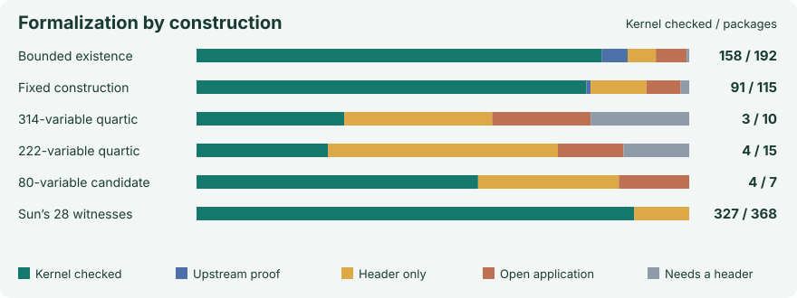
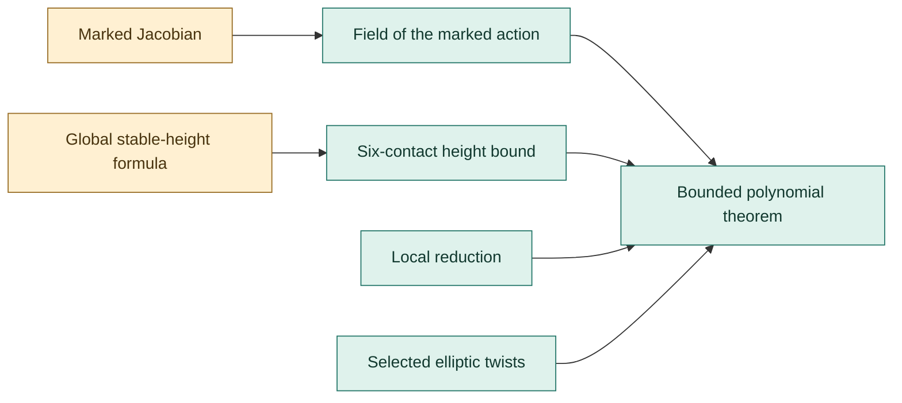

# A Diophantine definition of the integers in the rationals

Which rational numbers can occur as the first coordinate of a rational zero of an integer polynomial? Glazer’s proposed definition seeks one polynomial whose rational image is exactly $\mathbb Z$. This repository contains Lean sources for the argument, a mathematical blueprint, and a dashboard of the deductions and hypotheses.

**The main theorem available here is conditional.** One Lake project proves the bounded assertion from four named hypotheses. These include a uniform genus-two height bound and arithmetic statements about congruent-number elliptic curves. The conclusion covers *every* rational input and includes the bounds on the variables, degree and coefficients. [Buildable theorem](bounded/BoundedFromGenus.lean#L42) · [Four hypotheses](bounded/README.md) · [Mathematical blueprint](docs/theorem-blueprint.md)

[Read the results](docs/results.md) · [Browse the proof dashboard](dashboard/README.md) · [Download the interactive explorer](dashboard/index.html?raw=1) · [Explore the variable bounds](docs/variable-bound.md) · [Sources and conventions](docs/sources.md)

## Formalization dashboard

<!-- summary:begin -->

**487/582 packages have a locally kernel-checked deduction.** 10 are classified from pinned upstream proofs, 64 have only a formal header, 18 await an application or identification, and 3 need a Lean statement.

<!-- summary:end -->

The unit of counting is one mathematical package in the blueprint. A checked theorem may itself be an implication. A header defines the proposition that a later proof must establish. “Upstream” refers to a proof in the pinned source used by the construction. The chapter counts partition the inventory. A package may appear in several constructions in the chart. [Status definitions and chapter index](dashboard/README.md) · [Pinned upstream development](https://github.com/elliotglazer/diophantine-z-q/tree/eef7deb0317c2120956d27f2be1bc06cb5c8e5ba)

<!-- chapters:begin -->

| Chapter | Kernel checked | Upstream proof | Header only | Open application | Needs a header |
| --- | ---: | ---: | ---: | ---: | ---: |
| [Upstream bounded existence](dashboard/chapters/01.md) | 0/6 (0%) | 6 | 0 | 0 | 0 |
| [Six-contact height](dashboard/chapters/02.md) | 114/130 (88%) | 0 | 6 | 9 | 1 |
| [Independent rank reconstruction](dashboard/chapters/03.md) | 6/11 (55%) | 0 | 5 | 0 | 0 |
| [Class numbers and rational rank](dashboard/chapters/04.md) | 12/18 (67%) | 4 | 0 | 2 | 0 |
| [Glazer’s fixed construction](dashboard/chapters/05.md) | 58/76 (76%) | 0 | 12 | 4 | 2 |
| [The 314- and 222-variable quartics](dashboard/chapters/06.md) | 5/15 (33%) | 0 | 8 | 2 | 0 |
| [80-variable candidate](dashboard/chapters/07.md) | 4/7 (57%) | 0 | 2 | 1 | 0 |
| [Sun’s 28-witness construction](dashboard/chapters/08.md) | 272/303 (90%) | 0 | 31 | 0 | 0 |
| [Bounded-polynomial comparisons](dashboard/chapters/09.md) | 16/16 (100%) | 0 | 0 | 0 | 0 |

<!-- chapters:end -->

## The mathematical dependencies

<!-- graph:begin -->

<!-- graph:end -->

Arrows join a mathematical input to a result that uses it. The bounded theorem has further hypotheses listed in its Lean signature. For any statement, the explorer shows its immediate prerequisites and the results that use it. Download the HTML and open it in a browser, or open `dashboard/index.html` in a checkout. The mathematical overview and chapter tables also work directly on GitHub. [Explorer](dashboard/index.html?raw=1) · [All packages](dashboard/packages.json)

| Topic | What the repository proves | Remaining mathematical obligation |
| --- | --- | --- |
| Genus-two family | Computes the five weighted Igusa coordinates of a signed sextic. | Identify the polarized Jacobian and the marked endomorphism at the same moduli point. [Invariants](Lean/Lemmas/six-raw-jacobian/igusa/algebraic-class/SixPolarizedIgusa.lean) |
| Heights and reduction | Derives $h(j)<30h_F+150$ from the local discriminant and global height hypotheses. | Match the stable height and reduction data required by both the formula and the effective bound. [Exact inequality](Lean/Topics/marked-moduli/quaternion-marking/theta-class/minimal-discriminant/GlobalHeight.lean#L35) |
| Rank of elliptic twists | Reduces the required positive rank to a parity criterion and the simple-zero implication. | Instantiate the literature statements for the specified twists and their normalized $L$-functions. [Buildable rank argument](bounded/README.md) |
| Fewer variables | Encodes finite systems of monic equations by one additional rational witness. This yields the 85-variable projection comparison for the 222-coordinate family with its written source identifications. | Formalize those identifications and supply the family’s separate arithmetic assertion to obtain an integer definition. [Counts and proof](docs/variable-bound.md) |
| Sun’s first version | Gives a conditional equivalence for a fixed polynomial with 28 witnesses, or 29 total variables. | Prove the remaining height, simultaneous-prime and simultaneous-point statements. [The two implications](docs/sun-28.md) |

## Building the Lean code

| Directory | What `lake build` checks |
| --- | --- |
| Repository root · Lean 4.28.0 | Thirty foundational modules, including elliptic substitutions, witness transformations and elementary polynomial arguments. The package uses Lean’s standard library. [Entry point](Lean/Foundations/ZOverQ.lean) |
| `bounded/` · Lean 4.35.0 | Six modules giving an implication to the full bounded theorem. The manifest pins the upstream polynomial development and Mathlib. [Build instructions and theorem](bounded/README.md) |

The other sources are organized by mathematical package under [Lean/Topics](Lean/Topics/) and [Lean/Lemmas](Lean/Lemmas/). They span several upstream revisions and are provided for study alongside the two build targets. The dashboard records the statuses from the underlying formalization. The two commands above have a narrower, specified build scope.

The blueprint was organized with Bartosz Naskręcki’s **Labyrinth Exploration** skill. It records proof dependencies, alternate arguments and outstanding mathematical questions. The dashboard can be regenerated with `python3 dashboard/render.py --write` and checked with `python3 dashboard/render.py`. [Labyrinth Exploration](https://github.com/nasqret/labyrinth-exploration)
