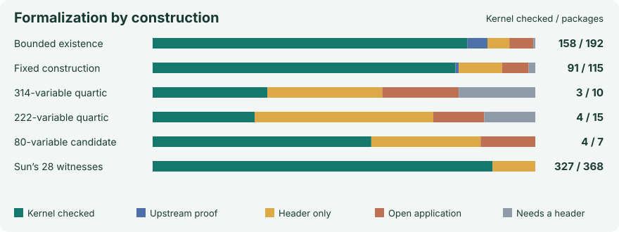
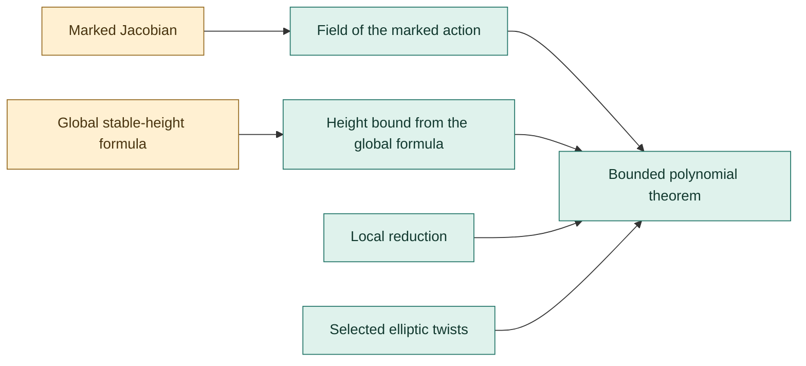

# Proof dashboard

**496/592 packages have a locally kernel-checked deduction.** 10 are classified from pinned upstream proofs, 64 have only a formal header, 19 await an application or identification, and 3 need a Lean statement.

[Download the interactive explorer](index.html?raw=1) · [Mathematical blueprint](../docs/theorem-blueprint.md)

## Qualitative existence

Lean proves that one polynomial defines the ordinary integers from explicit results on Prym varieties, isogenies, periods, reduction, heights and rank. Its proof constructs the common descent field and accounts for every exceptional rational parameter. The chapter counts below describe the original blueprint. The qualitative development has its own module inventory. [End-to-end theorem](../Lean/Lemmas/picard-application/PicardConclusion.lean) · [Twelve hypotheses and their sources](../README.md#the-twelve-hypotheses) · [Visual proof and seven chapters](../docs/blueprint/proof-map.md) · [Blueprint PDF](../docs/blueprint/blueprint.pdf) · [Module inventory](../picard/verification.json)

## Completion by chapter

| Chapter | Kernel checked | Upstream proof | Header only | Open application | Needs a header |
| --- | ---: | ---: | ---: | ---: | ---: |
| [Upstream bounded existence](chapters/01.md) | 0/6 (0%) | 6 | 0 | 0 | 0 |
| [Six-contact height](chapters/02.md) | 121/138 (88%) | 0 | 6 | 10 | 1 |
| [Independent rank reconstruction](chapters/03.md) | 6/11 (55%) | 0 | 5 | 0 | 0 |
| [Class numbers and rational rank](chapters/04.md) | 12/18 (67%) | 4 | 0 | 2 | 0 |
| [Glazer’s fixed construction](chapters/05.md) | 58/76 (76%) | 0 | 12 | 4 | 2 |
| [The 314- and 222-variable quartics](chapters/06.md) | 5/15 (33%) | 0 | 8 | 2 | 0 |
| [80-variable candidate](chapters/07.md) | 4/7 (57%) | 0 | 2 | 1 | 0 |
| [Sun’s 28-witness construction](chapters/08.md) | 272/303 (90%) | 0 | 31 | 0 | 0 |
| [Bounded-polynomial comparisons](chapters/09.md) | 18/18 (100%) | 0 | 0 | 0 | 0 |

## Dependencies of the bounded construction

## Reading the states

- **Kernel checked.** The formalization records a local kernel check of a lemma or a conditional implication.
- **Upstream proof.** An existing proof in the indicated upstream Lean development supplies the deduction.
- **Header only.** Lean expresses the proposed statement with its hypotheses and conclusion. Its proof remains to be supplied.
- **Open application.** A proof still needs an identification or a specialization to the objects of the construction.
- **Needs a header.** The mathematical task has been identified and still needs a Lean statement.

Each chapter lists its statements, prerequisites and named declarations. A source link is given when the declaration can be located unambiguously in this edition. Several named declarations may support one package.
