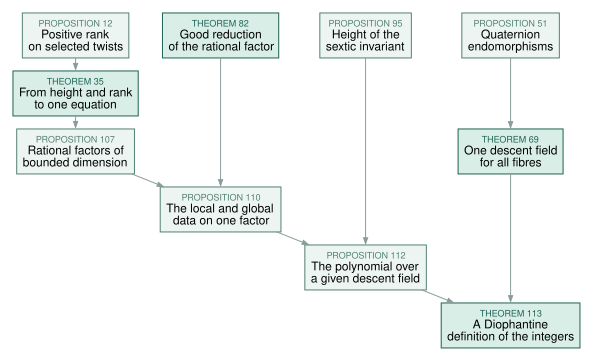

# A visual blueprint of the conditional theorem

Theorem 113 derives a Diophantine definition of the ordinary integers in the rationals from twelve explicit hypotheses. Select a section to read its statements, or follow a single result through its prerequisites and applications.

[Download the interactive proof map](explorer.html?raw=1) · [Open the complete vector diagram](proof-dependencies.svg) · [Download the linked diagram](proof-dependencies.svg?raw=1)

Open the downloaded interactive map in a browser. In the downloaded vector diagram, each statement opens its Lean source, and citations beneath hypotheses open the papers. An arrow runs from a prerequisite to the statement that uses it. The overview above suppresses intermediate lemmas.

| Section | Statements | Deductions and hypotheses |
| --- | --- | --- |
| [1. The target and the rank criterion](sections/rank.md) | 1–12 | 6 proved, 2 external |
| [2. From height and rank to one equation](sections/polynomial.md) | 13–35 | 22 proved, 0 external |
| [3. The Picard sextic and its endomorphisms](sections/picard.md) | 36–51 | 12 proved, 2 external |
| [4. Descent of a rational abelian variety](sections/descent.md) | 52–69 | 10 proved, 4 external |
| [5. Good reduction outside the odd contacts](sections/reduction.md) | 70–83 | 11 proved, 2 external |
| [6. Periods, invariants and stable heights](sections/periods.md) | 84–96 | 7 proved, 1 external |
| [7. The global height bound and the defining polynomial](sections/global-height.md) | 97–113 | 15 proved, 1 external |

The numbering covers 83 proved implications, 15 definitions, 12 hypotheses and 3 clauses of the joint height hypothesis. All 157 dependencies appear in the complete diagram.

The references identify the published results invoked for each external premise. The accompanying text specifies any identification of fields, models or height normalizations required for their application.
