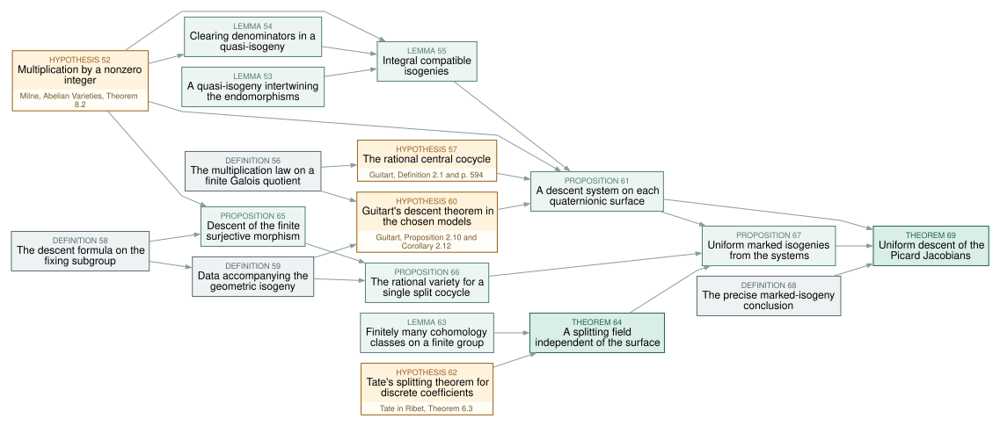

# 4. Descent of a rational abelian variety

[Leitfaden and contents](../proof-map.md) · [Complete diagram](../proof-dependencies.svg)

The effective height theorem applies to abelian varieties over the rationals. Our Jacobians are defined over a larger field. For each fibre, compatible isogenies produce a scalar cocycle. Theorem [64](#s-64) first chooses a single field splitting all these cocycles. Only then do we descend a power of each Jacobian. The order of these choices yields the uniform dimension bound in Theorem [69](#s-69).

Let $`G_L=\mathrm{Gal}(L/\mathbb{Q})`$ for a finite Galois number field $`L`$. An isogeny $`\,{}^\sigma Y\to Y`$ is compatible if it intertwines the pullback of every rational endomorphism with that endomorphism. Composition uses the canonical isomorphism for successive base changes.

The diagram shows dependencies within this section. The numbered links after each statement also include its prerequisites and applications in other sections.

### Hypothesis 52. Multiplication by a nonzero integer

On an abelian variety over a field of characteristic zero, multiplication by every nonzero integer is finite, flat and surjective.

**Literature.** Milne, *Abelian Varieties*, Theorem 8.2 [MilneAV](https://www.jmilne.org/math/xnotes/AVs.pdf). The theorem gives an isogeny which in characteristic zero is étale. The Lean predicate uses its finiteness, flatness and surjectivity.

[Lean statement](https://github.com/nasqret/z-in-q-lean/blob/95357929cf16cedd3dd1960c11060cb923f5bdca/Lean/Lemmas/picard-application/GuitartSurfaces.lean#L23-L26) · [Milne, Abelian Varieties, Theorem 8.2](https://www.jmilne.org/math/xnotes/AVs.pdf#page=13)

Used in [54](#s-54), [55](#s-55), [61](#s-61), [65](#s-65).

### Lemma 53. A quasi-isogeny intertwining the endomorphisms

For a rational twist equipped with the displayed quaternion generators, every conjugate over the indicated characteristic-zero field has a quasi-isogeny to the original fibre, with inverse, intertwining its entire rational endomorphism ring.

**Derivation.** Start with the isomorphism between the conjugate Jacobians supplied by [41](picard.md#s-41) after base change. Conjugation may alter the two quaternion generators. Correct the map by an inner intertwiner between the two embeddings. Compatibility for $`i,j`$ extends to the algebra they generate.

[Lean proof](https://github.com/nasqret/z-in-q-lean/blob/95357929cf16cedd3dd1960c11060cb923f5bdca/Lean/Lemmas/picard-application/PicardConjugateEnd.lean#L175-L207)

Prerequisites [41](picard.md#s-41), [42](picard.md#s-42).

Used in [55](#s-55).

### Lemma 54. Clearing denominators in a quasi-isogeny

If rationalized arrows $`\mu:A\to B`$ and $`\nu:B\to A`$ are inverse, and the separation, finiteness and surjectivity hypotheses below hold, some nonzero integral multiple of $`\mu`$ is represented by a finite surjective morphism.

**Derivation.** Clear denominators in the two arrows and in the inverse identities. The resulting composites are nonzero integer multiplications. Finiteness on the source and surjectivity on the target give the corresponding assertions for the representative. For abelian varieties [52](#s-52) supplies the multiplication hypotheses.

[Lean proof](https://github.com/nasqret/z-in-q-lean/blob/95357929cf16cedd3dd1960c11060cb923f5bdca/Lean/Lemmas/picard-application/PicardIntegralHom.lean#L66-L84)

Prerequisites [52](#s-52).

Used in [55](#s-55).

### Lemma 55. Integral compatible isogenies

On an abelian variety in characteristic zero, a compatible system of rational quasi-isogenies can be represented, after nonzero scalar multiplication for each conjugate, by actual finite surjective compatible isogenies.

**Derivation.** Apply [54](#s-54) separately to each inverse pair. Multiplication by its integer denominator preserves the intertwining square for every endomorphism. On the Picard family [53](#s-53) and choice supply the rational system.

[Lean proof](https://github.com/nasqret/z-in-q-lean/blob/95357929cf16cedd3dd1960c11060cb923f5bdca/Lean/Lemmas/picard-application/GuitartSurfaces.lean#L37-L49)

Prerequisites [53](#s-53), [54](#s-54), [52](#s-52).

Used in [61](#s-61).

### Definition 56. The multiplication law on a finite Galois quotient

A scalar function $`c:G_L^2\to\mathbb{Q}^\times`$ is a multiplier of $`\mu`$ if $`\mu_\sigma\circ{}^\sigma\mu_\tau=c(\sigma,\tau)\mu_{\sigma\tau}`$ after the canonical identification $`\,{}^{\sigma\tau}Y\simeq{}^\sigma({}^\tau Y)`$.

**Use.** The equality holds in rationalized homomorphisms of the specified $`L`$-schemes. The base-change comparison fixes the order of the factors.

[Lean statement](https://github.com/nasqret/z-in-q-lean/blob/95357929cf16cedd3dd1960c11060cb923f5bdca/Lean/Lemmas/picard-application/GuitartCocycle.lean#L38-L42)

Used in [57](#s-57), [60](#s-60).

### Hypothesis 57. The rational central cocycle

For an abelian surface with the full quaternion presentation and compatible isogenies over $`L`$, one can choose integral representatives and a rational multiplier with $`c(1,1)=1`$ satisfying the cocycle identity.

**Literature.** Guitart constructs the multiplier from $`\mu_\sigma\circ{}^\sigma\mu_\tau\circ\mu_{\sigma\tau}^{-1}`$ [Guitart](https://doi.org/10.4171/RMI/686). Compatibility puts it in the centre $`\mathbb{Q}^\times`$. The stated finite-quotient version also requires these choices over $`L`$ with the precise pullback identity in [56](#s-56). Its existence is assumed.

[Lean statement](https://github.com/nasqret/z-in-q-lean/blob/95357929cf16cedd3dd1960c11060cb923f5bdca/Lean/Lemmas/picard-application/GuitartSurfaces.lean#L60-L66) · [Guitart, Definition 2.1 and p. 594](https://ems.press/content/serial-article-files/38384?nt=1#page=4)

Prerequisites [56](#s-56), [42](picard.md#s-42).

Used in [61](#s-61).

### Definition 58. The descent formula on the fixing subgroup

Let $`M`$ split the scalar cocycle through a cochain $`b`$ and put $`E=\mathbb{Q}(b(g):g\in G_M)`$. The restriction formula compares a conjugate of the geometric arrow $`\kappa`$ over $`M`$ with $`\kappa`$ composed with the action of the inverse coefficient $`b(\sigma|_M)^{-1}`$.

**Use.** The source and target carry the actions coming from their models over $`M`$. The formula is an equality in $`\mathbb{Q}\otimes_{\mathbb{Z}}\mathrm{Hom}`$. Identifying these two sides is part of the geometric input.

[Lean statement](https://github.com/nasqret/z-in-q-lean/blob/95357929cf16cedd3dd1960c11060cb923f5bdca/Lean/Lemmas/picard-application/GuitartFormula.lean#L18-L23)

Used in [59](#s-59), [65](#s-65).

### Definition 59. Data accompanying the geometric isogeny

For $`J/M`$ and its indicated power $`A`$, the data comprise a rational abelian variety $`B`$ of dimension $`2[E:\mathbb{Q}]`$, an isomorphism $`\mathrm{End}^0_{\mathbb{Q}} B\simeq E\otimes_{\mathbb{Q}}\mathrm{End}^0_{\overline{\mathbb{Q}}}J`$, the quaternion generators, the coefficient representation on $`A`$, and a geometric finite surjective $`\kappa:A\to B`$ satisfying [58](#s-58).

**Use.** The arrow, the endomorphism algebra and the restriction law belong to a single $`B`$. Descent and the construction of a field action will use that same rational variety.

[Lean statement](https://github.com/nasqret/z-in-q-lean/blob/95357929cf16cedd3dd1960c11060cb923f5bdca/Lean/Lemmas/picard-application/GuitartApplication.lean#L55-L74)

Prerequisites [58](#s-58).

Used in [60](#s-60), [66](#s-66).

### Hypothesis 60. Guitart's descent theorem in the chosen models

For a quaternionic surface obtained from a number-field model, a compatible integral system with normalized multiplier, and any cochain trivializing that multiplier over $`M`$, the data in [59](#s-59) exist for the power with $`[E:\mathbb{Q}]`$ factors.

**Literature.** Guitart, Proposition 2.10 and Corollary 2.12, construct the geometric isogeny and identify the full rational endomorphism algebra [Guitart](https://doi.org/10.4171/RMI/686). This statement also matches the regular representation and the restriction of his formula to the base-change isomorphisms in [58](#s-58). That match is an explicit assumption.

[Lean statement](https://github.com/nasqret/z-in-q-lean/blob/95357929cf16cedd3dd1960c11060cb923f5bdca/Lean/Lemmas/picard-application/GuitartSurfaces.lean#L73-L82) · [Guitart, Proposition 2.10 and Corollary 2.12](https://ems.press/content/serial-article-files/38384?nt=1#page=7)

Prerequisites [59](#s-59), [56](#s-56), [42](picard.md#s-42).

Used in [61](#s-61).

### Proposition 61. A descent system on each quaternionic surface

Suppose the Picard surfaces have dimension two and the quaternion presentation outside a specified finite set. The multiplier and descent hypotheses give a normalized cocycle for every such surface, together with the geometric data for every splitting cochain.

**Derivation.** Apply [55](#s-55) on the actual twist. Apply [57](#s-57) to these arrows, then [60](#s-60) to the resulting arrows and cocycle. Entry [40](picard.md#s-40) supplies the dimension in this application.

[Lean proof](https://github.com/nasqret/z-in-q-lean/blob/95357929cf16cedd3dd1960c11060cb923f5bdca/Lean/Lemmas/picard-application/GuitartSurfaces.lean#L100-L113)

Prerequisites [52](#s-52), [55](#s-55), [57](#s-57), [60](#s-60), [40](picard.md#s-40).

Used in [67](#s-67), [69](#s-69).

### Hypothesis 62. Tate's splitting theorem for discrete coefficients

For every finite Galois $`L/\mathbb{Q}`$, every $`2`$-cocycle of $`G_L`$ with values in the discrete group $`\overline{\mathbb{Q}}^\times`$ with trivial action becomes a coboundary on $`\mathrm{Gal}(\overline{\mathbb{Q}}/\mathbb{Q})`$, with a locally constant $`1`$-cochain.

**Literature.** Use Tate's vanishing theorem as recorded in Ribet, Theorem 6.3 [Ribet](https://math.berkeley.edu/~ribet/Articles/korea.pdf). The trivial action on the coefficient group is essential in this application.

[Lean statement](https://github.com/nasqret/z-in-q-lean/blob/95357929cf16cedd3dd1960c11060cb923f5bdca/Lean/Lemmas/picard-application/GuitartApplication.lean#L104-L107) · [Tate in Ribet, Theorem 6.3](https://math.berkeley.edu/~ribet/Articles/korea.pdf#page=13)

Used in [64](#s-64).

### Lemma 63. Finitely many cohomology classes on a finite group

For the trivial representation of a finite group on the multiplicative group of an algebraically closed field, the second cohomology group in the declaration is finite.

**Derivation.** A class is killed by the group order. Taking roots in the coefficient group adjusts a representative to a cocycle with values among roots of unity of bounded order. There are finitely many such functions on the finite square of the group.

[Lean proof](https://github.com/nasqret/z-in-q-lean/blob/95357929cf16cedd3dd1960c11060cb923f5bdca/picard/UniformDescent.lean#L185-L205)

Used in [64](#s-64).

### Theorem 64. A splitting field independent of the surface

For fixed finite Galois $`L/\mathbb{Q}`$, one finite Galois field $`M`$ containing $`L`$ splits every rational multiplier on $`G_L`$. For each multiplier there is a splitting cochain on $`G_M`$ whose coefficient field has degree at most $`[M:\mathbb{Q}]`$.

**Derivation.** Apply [62](#s-62) to representatives of the finitely many classes in [63](#s-63). Their locally constant cochains factor through one finite quotient. A coboundary adjustment handles the other representatives. Products of cochain values are rational multiples of other values, so their $`\mathbb{Q}`$-span is the coefficient field and has dimension at most $`|G_M|`$.

[Lean proof](https://github.com/nasqret/z-in-q-lean/blob/95357929cf16cedd3dd1960c11060cb923f5bdca/picard/UniformDescent.lean#L301-L318)

Prerequisites [62](#s-62), [63](#s-63).

Used in [67](#s-67).

### Proposition 65. Descent of the finite surjective morphism

Suppose a geometric finite surjective $`\kappa`$ between scalar extensions of two abelian varieties over $`M`$ satisfies [58](#s-58) for a normalized coboundary. A finite surjective homomorphism already exists over $`M`$.

**Derivation.** The splitting law gives $`b(1)=1`$. On $`\mathrm{Gal}(\overline{\mathbb{Q}}/M)`$ the coefficient action is the identity. The integral descent argument recovers equality of morphisms from the rationalized equality. Galois descent gives the morphism and finite surjectivity descends under base change.

[Lean proof](https://github.com/nasqret/z-in-q-lean/blob/95357929cf16cedd3dd1960c11060cb923f5bdca/Lean/Lemmas/picard-application/GuitartFormula.lean#L34-L46)

Prerequisites [52](#s-52), [58](#s-58).

Used in [66](#s-66).

### Proposition 66. The rational variety for a single split cocycle

Given [59](#s-59) and a normalized splitting cochain, the rational variety acquires central $`E`$-scalars and quaternion generators. There is a finite surjective morphism from the indicated power over $`M`$ to its base change.

**Derivation.** Transfer the generators and scalars across Guitart's tensor-product isomorphism and descend $`\kappa`$ by [65](#s-65). Both operations apply to the variety in the same data.

[Lean proof](https://github.com/nasqret/z-in-q-lean/blob/95357929cf16cedd3dd1960c11060cb923f5bdca/Lean/Lemmas/picard-application/GuitartApplication.lean#L84-L97)

Prerequisites [59](#s-59), [65](#s-65).

Used in [67](#s-67).

### Proposition 67. Uniform marked isogenies from the systems

A family of descent systems over a single $`L`$ admits one extension $`M`$ and marked isogenies for all nonexceptional fibres. Every coefficient degree is bounded by $`[M:\mathbb{Q}]`$.

**Derivation.** Choose $`M`$ by [64](#s-64) before choosing a fibre. Obtain a splitting cochain for its cocycle, instantiate the geometric assertion in [61](#s-61), and apply [66](#s-66).

[Lean proof](https://github.com/nasqret/z-in-q-lean/blob/95357929cf16cedd3dd1960c11060cb923f5bdca/Lean/Lemmas/picard-application/GuitartApplication.lean#L125-L143)

Prerequisites [64](#s-64), [61](#s-61), [66](#s-66).

Used in [69](#s-69).

### Definition 68. The precise marked-isogeny conclusion

For each allowed $`t`$ outside one finite exceptional set there is a number field $`E`$ of degree $`m\le D`$, a rational quaternionic variety $`B`$ of dimension $`2m`$, and an $`M`$-isogeny $`A_t^m\to B_M`$.

**Use.** In the formal product convention the positive $`m`$-fold power is indexed by $`m-1`$. The scalar field $`M`$, the embedding of $`k_0`$ and the bound $`D`$ do not depend on $`t`$.

[Lean statement](https://github.com/nasqret/z-in-q-lean/blob/95357929cf16cedd3dd1960c11060cb923f5bdca/Lean/Lemmas/picard-application/PicardPolynomial.lean#L167-L174)

Used in [69](#s-69).

### Theorem 69. Uniform descent of the Picard Jacobians

There exist $`M/\mathbb{Q}`$ finite Galois, an embedding $`k_0\hookrightarrow M`$ and a finite exceptional set on the $`s`$-line. For every remaining noncontact fibre a positive power of its twisted Jacobian is isogenous over $`M`$ to a rational quaternionic abelian variety. The exponent is at most $`[M:\mathbb{Q}]`$.

**Derivation.** Start with $`L=k_0(\sqrt{-1})`$ and take the coordinate image of the set from [51](picard.md#s-51). Use the prescribed positive twist of the fibre, its dimension [40](picard.md#s-40), and [61](#s-61). Apply [67](#s-67) once to the whole family.

[Lean proof](https://github.com/nasqret/z-in-q-lean/blob/95357929cf16cedd3dd1960c11060cb923f5bdca/Lean/Lemmas/picard-application/PicardConclusion.lean#L30-L50)

Prerequisites [51](picard.md#s-51), [40](picard.md#s-40), [61](#s-61), [67](#s-67), [68](#s-68).

Used in [113](global-height.md#s-113).
