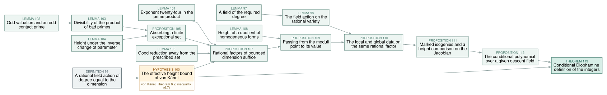

# 7. The global height bound and the defining polynomial

[Leitfaden and contents](../proof-map.md) · [Complete diagram](../proof-dependencies.svg)

For a rational factor of bounded dimension, von Känel's estimate gives the twenty-fourth power of the product of the bad primes. The local result bounds that product by the odd-contact product up to a fixed factor. The period comparison recovers the height of the parameter. After the finitely many exceptional heights are absorbed into one coefficient, Theorem [35](polynomial.md#s-35) applies. Theorem [113](#s-113) records the quantifiers and all twelve hypotheses together.

For a fixed set $`S_0`$ and a noncontact parameter $`s`$, write $`S(s)=S_0\cup\{p:v_p(N(s))\text{ is odd}\}`$. A rational abelian variety of dimension $`g`$ is of $`\mathrm{GL}_2`$-type in the required sense if a number field of degree $`g`$ embeds in its rational endomorphism algebra.

The diagram shows dependencies within this section. The numbered links after each statement also include its prerequisites and applications in other sections.



<a id="s-97"></a>

### Lemma 97. A field of the required degree

Let $`E`$ be a number field acting by central scalars in the nonzero algebra in the statement, with compatible $`\mathbb{Q}`$-algebra structure. If the algebra contains $`i,j`$ with $`i^2=-3,\ j^2=2,\ ji=-ij`$, it contains a number field of degree $`2[E:\mathbb{Q}]`$.

**Derivation.** If $`-3`$ is a nonsquare in $`E`$, use $`i`$. Otherwise write $`r^2=-3`$. The squares of elements $`bj+cij`$ are $`2(b+rc)(b-rc)`$ and represent every element of $`E`$. Choose a nonsquare of $`E`$ and adjoin its represented square root. Irreducibility of the quadratic gives an embedding.

[Lean proof](https://github.com/nasqret/z-in-q-lean/blob/95357929cf16cedd3dd1960c11060cb923f5bdca/Lean/Lemmas/picard-application/GeneralQuaternionField.lean#L104-L109)

Used in [98](#s-98).

<a id="s-98"></a>

### Lemma 98. The field action on the rational variety

For the rational quaternionic variety $`B`$ descended with central coefficient field $`E`$, there is an action over $`\mathbb{Q}`$ of a number field of degree $`\dim B=2[E:\mathbb{Q}]`$.

**Derivation.** Apply [97](#s-97) in the actual algebra $`\mathbb{Q}\otimes_{\mathbb{Z}}\mathrm{End}_{\mathbb{Q}} B`$ to the two endomorphisms in its presentation.

[Lean proof](https://github.com/nasqret/z-in-q-lean/blob/95357929cf16cedd3dd1960c11060cb923f5bdca/Lean/Lemmas/picard-application/PicardPolynomial.lean#L35-L40)

Prerequisites [97](#s-97).

Used in [110](#s-110).

<a id="s-99"></a>

### Definition 99. A rational field action of degree equal to the dimension

The required field action on $`B/\mathbb{Q}`$ in dimension $`g`$ is a unital $`\mathbb{Q}`$-algebra embedding of a number field of degree $`g`$ into $`\mathbb{Q}\otimes_{\mathbb{Z}}\mathrm{End}_{\mathbb{Q}} B`$.

**Use.** The code asks for a unital algebra homomorphism. For the positive-dimensional abelian varieties of the application the target is nonzero, so every such homomorphism from a field is injective.

[Lean statement](https://github.com/nasqret/z-in-q-lean/blob/95357929cf16cedd3dd1960c11060cb923f5bdca/picard/PicardAssembly.lean#L69-L71)

Used in [100](#s-100).

<a id="s-100"></a>

### Hypothesis 100. The effective height bound of von Känel

If $`B/\mathbb{Q}`$ is abelian of dimension $`g\gt 0`$, admits a number field of degree $`g`$ in its rational endomorphism algebra, and has good reduction off the finite set of primes $`S`$, then $`h_F(B)\le V_g(S)`$. Here, with $`n=\prod_{p\in S}p`$ and $`r=|\{p\in S:p\le2g+1\}|`$,

```math
v=(2g+1)^{6r}n^2,\qquad V_g(S)=g\{18000v^{12}+(8g)^6\log v\}.
```

**Literature.** Von Känel, Theorem 6.2, equation (6.7) [vK](https://doi.org/10.1017/fms.2021.29). This form on a generic fibre uses the abelian scheme over $`\mathbb{Z}[1/n]`$ supplied by good reduction and extension of its endomorphisms by the Néron mapping property.

[Lean statement](https://github.com/nasqret/z-in-q-lean/blob/95357929cf16cedd3dd1960c11060cb923f5bdca/picard/PicardAssembly.lean#L79-L82) · [von Känel, Theorem 6.2, inequality (6.7)](https://doi.org/10.1017/fms.2021.29)

Prerequisites [99](#s-99).

Used in [107](#s-107), [113](#s-113).

<a id="s-101"></a>

### Lemma 101. Exponent twenty-four in the prime product

For each $`g`$ there is a dimension-dependent explicit coefficient $`C_g`$ such that $`V_g(S)\le C_g(\prod_{p\in S}p)^{24}`$ for every finite set of primes $`S`$.

**Derivation.** In the formula of [100](#s-100) at most $`2g+1`$ primes contribute to the small-prime factor. Bound $`\log v`$ by $`v^{12}`$ for $`v\ge1`$. The square of the prime product in $`v`$ is raised to the twelfth power.

[Lean proof](https://github.com/nasqret/z-in-q-lean/blob/95357929cf16cedd3dd1960c11060cb923f5bdca/bounded/QualitativeHeight.lean#L244-L280)

Used in [107](#s-107).

<a id="s-102"></a>

### Lemma 102. Odd valuation and an odd contact prime

For a prime $`p\gt 61`$ and $`t\notin\mathcal C`$, $`v_p(N(s))`$ is odd if and only if $`p`$ is an odd contact prime for $`t`$, where $`s=5+120/t`$.

**Derivation.** In [36](picard.md#s-36) the coordinate multiplier is a sixth power and $`1920`$ is a $`p`$-adic unit. Outside the small primes the six contacts are distinct modulo $`p`$. A denominator contributes an even valuation to their product.

[Lean proof](https://github.com/nasqret/z-in-q-lean/blob/95357929cf16cedd3dd1960c11060cb923f5bdca/bounded/QualitativeHeight.lean#L101-L116)

Prerequisites [36](picard.md#s-36).

Used in [103](#s-103).

<a id="s-103"></a>

### Lemma 103. Divisibility of the product of bad primes

If every prime of a finite set of bad primes is fixed or has odd valuation on $`N(s)`$, their product divides the product of a fixed integer and $`M(t)`$.

**Derivation.** The fixed integer absorbs the prescribed primes and exceptions in $`S_{\rm mul}`$. For every remaining prime use [102](#s-102) and the definition of $`M(t)`$. The prime factors occur with exponent one.

[Lean proof](https://github.com/nasqret/z-in-q-lean/blob/95357929cf16cedd3dd1960c11060cb923f5bdca/bounded/QualitativeHeight.lean#L136-L149)

Prerequisites [102](#s-102).

Used in [105](#s-105).

<a id="s-104"></a>

### Lemma 104. Height under the inverse change of parameter

For a rational input $`t`$, its height is at most the height of its transformed parameter plus the fixed coordinate cost in the declaration.

**Derivation.** Away from zero solve $`t=120/(s-5)`$ and apply the elementary height inequalities for quotients and sums. The formal statement also covers $`t=0`$ by direct evaluation.

[Lean proof](https://github.com/nasqret/z-in-q-lean/blob/95357929cf16cedd3dd1960c11060cb923f5bdca/bounded/QualitativeHeight.lean#L154-L166)

Used in [105](#s-105).

<a id="s-105"></a>

### Proposition 105. Absorbing a finite exceptional set

Suppose, outside finitely many noncontact $`s`$, that $`h(s)\le A(\prod_{p\in S(s)}p)^{24}+B`$ with $`A\ge0`$ and with the bad primes supported as in [103](#s-103). There exists an integer $`m\ge1`$ giving [2](rank.md#s-2) for all $`t\notin\mathcal C`$.

**Derivation.** Bound the heights of the finitely many exceptional $`s`$ together. Apply [103](#s-103) elsewhere. The inverse fractional linear transformation bounds $`h(t)`$ by $`h(s)`$ plus a fixed constant. Since $`M(t)\ge1`$, one coefficient absorbs all additive constants and the finite exceptions.

[Lean proof](https://github.com/nasqret/z-in-q-lean/blob/95357929cf16cedd3dd1960c11060cb923f5bdca/bounded/QualitativeHeight.lean#L171-L227)

Prerequisites [2](rank.md#s-2), [103](#s-103), [104](#s-104).

Used in [107](#s-107).

<a id="s-106"></a>

### Lemma 106. Good reduction away from the prescribed set

A rational factor whose reduction implication holds at each prime $`p\gt 3`$ outside $`S_0`$ with the required cluster data has good reduction outside $`S(s)`$, provided $`2,3\in S_0`$ and $`N(s)\ne0`$.

**Derivation.** For $`p\notin S(s)`$ use [83](reduction.md#s-83) to obtain the cluster data and apply the reduction field of the rational factor. In [110](#s-110) it is furnished by [82](reduction.md#s-82).

[Lean proof](https://github.com/nasqret/z-in-q-lean/blob/95357929cf16cedd3dd1960c11060cb923f5bdca/picard/PicardAssembly.lean#L153-L157)

Prerequisites [83](reduction.md#s-83).

Used in [107](#s-107).

<a id="s-107"></a>

### Proposition 107. Rational factors of bounded dimension suffice

Suppose $`0\lt g_s\le G`$, $`B_s/\mathbb{Q}`$ is a rational factor of dimension $`g_s`$ satisfying the reduction and field-action conditions, and $`h(R(s))\le a\max(1,h_F(B_s))+b`$ off a finite set. With the stated height and rank hypotheses, [1](rank.md#s-1) follows.

**Derivation.** Sum $`C_g`$ over $`0\le g\le G`$ to bound every fibre coefficient. Apply [106](#s-106), [100](#s-100) and [101](#s-101) to $`B_s`$. Entry [85](periods.md#s-85) turns the estimate for $`R`$ into one for $`s`$. Include $`s=5`$ among the exceptions, apply [105](#s-105) and then [35](polynomial.md#s-35).

[Lean proof](https://github.com/nasqret/z-in-q-lean/blob/95357929cf16cedd3dd1960c11060cb923f5bdca/picard/PicardAssembly.lean#L202-L234)

Prerequisites [100](#s-100), [101](#s-101), [85](periods.md#s-85), [105](#s-105), [106](#s-106), [35](polynomial.md#s-35).

Used in [109](#s-109).

<a id="s-108"></a>

### Lemma 108. Height of a quotient of homogeneous forms

For finitely many pairs of homogeneous forms of equal degree on a fixed projective space over a number field, there are constants $`a\ge0,b`$ such that every represented rational value $`r`$ satisfies $`h(r)\le a h(z)+b`$ at its representing vector $`z`$.

**Derivation.** Evaluate the two coordinate functions at each place and apply the product formula. Take common upper bounds for the finitely many degrees and coefficient-height constants. The definition of representation requires a nonzero denominator.

[Lean proof](https://github.com/nasqret/z-in-q-lean/blob/95357929cf16cedd3dd1960c11060cb923f5bdca/picard/PicardAssembly.lean#L269-L291)

Used in [109](#s-109).

<a id="s-109"></a>

### Proposition 109. Passing from the moduli point to its value

In the hypotheses of [107](#s-107), it suffices to represent $`R(s)`$ in one of finitely many fixed homogeneous charts and bound the projective height of the representing vector affinely by $`\max(1,h_F(B_s))`$.

**Derivation.** Compose the height comparison with [108](#s-108). Its slope is nonnegative, so the inequality is preserved. Apply [107](#s-107).

[Lean proof](https://github.com/nasqret/z-in-q-lean/blob/95357929cf16cedd3dd1960c11060cb923f5bdca/picard/PicardAssembly.lean#L296-L311)

Prerequisites [108](#s-108), [107](#s-107).

Used in [110](#s-110).

<a id="s-110"></a>

### Proposition 110. The local and global data on the same rational factor

Over a fixed normal field, suppose each remaining twisted Jacobian has a global power quotient to a rational quaternionic variety, with bounded coefficient degree and a chart height bound in terms of that rational variety. Under the displayed reduction, height and rank hypotheses, [1](rank.md#s-1) follows.

**Derivation.** Recover $`t`$ from $`s\ne5`$. Use [81](reduction.md#s-81) on the global quotient, then [82](reduction.md#s-82) for the resulting local quotients and [98](#s-98) on the same $`B_s`$. Its dimension is at most twice the coefficient-degree bound. These are precisely the rational factors and comparisons needed in [109](#s-109).

[Lean proof](https://github.com/nasqret/z-in-q-lean/blob/95357929cf16cedd3dd1960c11060cb923f5bdca/Lean/Lemmas/picard-application/PicardPolynomial.lean#L129-L164)

Prerequisites [81](reduction.md#s-81), [82](reduction.md#s-82), [98](#s-98), [109](#s-109).

Used in [111](#s-111).

<a id="s-111"></a>

### Proposition 111. Marked isogenies and a height comparison on the Jacobian

Suppose marked isogenies over one $`M`$ are available off a finite set, and a fixed chart compares the projective height with the stable height of the actual twisted Jacobian off a second finite set. Given the displayed general reduction, height and rank assumptions, there is a defining polynomial.

**Derivation.** Take the union of the two sets. The isogeny gives the global quotient. Apply [96](periods.md#s-96) to compare the height of the Jacobian with the height of the rational factor, using scalar-extension invariance for that same factor. Insert the resulting chart inequality into [110](#s-110).

[Lean proof](https://github.com/nasqret/z-in-q-lean/blob/95357929cf16cedd3dd1960c11060cb923f5bdca/Lean/Lemmas/picard-application/PicardPolynomial.lean#L189-L229)

Prerequisites [96](periods.md#s-96), [110](#s-110).

Used in [112](#s-112).

<a id="s-112"></a>

### Proposition 112. The conditional polynomial over a given descent field

Over a fixed normal field supporting the marked isogenies, the general sextic period statement and the other displayed height, reduction and rank assumptions imply [1](rank.md#s-1).

**Derivation.** Use the rational invariant line, empty moduli exceptional set, and constants $`84,289200`$ from [95](periods.md#s-95). Substitute these data in [111](#s-111).

[Lean proof](https://github.com/nasqret/z-in-q-lean/blob/95357929cf16cedd3dd1960c11060cb923f5bdca/Lean/Lemmas/picard-application/PicardPeriods.lean#L175-L187)

Prerequisites [111](#s-111), [95](periods.md#s-95).

Used in [113](#s-113).

<a id="s-113"></a>

### Theorem 113. Conditional Diophantine definition of the integers

Assume the Prym and descent results [44](picard.md#s-44), [48](picard.md#s-48), [52](descent.md#s-52), [57](descent.md#s-57), [60](descent.md#s-60) and [62](descent.md#s-62). Let $`h_F`$ satisfy the height comparisons [90](periods.md#s-90) and the bound [100](#s-100). Assume also the reduction criteria [77](reduction.md#s-77), [80](reduction.md#s-80) and the rank hypotheses [5](rank.md#s-5), [6](rank.md#s-6). Then a polynomial with integer coefficients defines exactly $`\mathbb{Z}`$ by existential projection over $`\mathbb{Q}`$, as in [1](rank.md#s-1).

**Derivation.** By [69](descent.md#s-69) choose $`M`$, its embedding of $`k_0`$, the finite exceptional set and the uniform marked isogenies. Specialize [90](periods.md#s-90) to this $`M`$. The resulting stable height, reverse isogeny estimate, base-change identity and period assertion fill the hypotheses of [112](#s-112). The following code includes the complete final proof.

[Lean proof](https://github.com/nasqret/z-in-q-lean/blob/95357929cf16cedd3dd1960c11060cb923f5bdca/Lean/Lemmas/picard-application/PicardConclusion.lean#L65-L76)

Prerequisites [69](descent.md#s-69), [90](periods.md#s-90), [100](#s-100), [77](reduction.md#s-77), [80](reduction.md#s-80), [5](rank.md#s-5), [6](rank.md#s-6), [112](#s-112).
