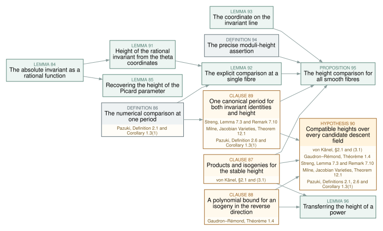

# 6. Periods, invariants and stable heights

[Leitfaden and contents](../proof-map.md) · [Complete diagram](../proof-dependencies.svg)

We compare a rational function of the original parameter with the stable height of its Jacobian. Both invariant identities must hold at one period of the same principally polarized surface. Under this hypothesis the calculation is uniform in the fibre. Proposition [95](#s-95) bounds the height of the invariant. Lemma [96](#s-96) transfers the height estimate along the isogeny to the descended variety.

Write $`R`$ for the absolute invariant $`Q_2(f)^5/\mathrm{disc}(f)`$ in the ordinary sextic coefficient convention. The analytic expressions $`h_{10}`$ and $`h_{12}`$ below are Siegel modular forms in the even half-characteristic theta constants. All stable Faltings heights used in the arithmetic bound have von Känel's normalization.

The diagram shows dependencies within this section. The numbered links after each statement also include its prerequisites and applications in other sections.



<a id="s-84"></a>

### Lemma 84. The absolute invariant as a rational function

For every noncontact $`t`$,

```math
R=\frac{Q_2(f_{U,V})^5}{\mathrm{disc}(f_{U,V})}
         =\frac{(J(t)+4)^5}{200000J(t)^3}.
```

**Derivation.** The quadratic transvectant and [38](picard.md#s-38) are polynomials in $`U,V`$. Substitute the two sixth powers and simplify with the rational coordinate formula. Ordinary common scaling of the sextic cancels between weights ten and ten.

[Lean proof](https://github.com/nasqret/z-in-q-lean/blob/95357929cf16cedd3dd1960c11060cb923f5bdca/picard/PicardDiscriminant.lean#L162-L175)

Prerequisites [38](picard.md#s-38), [37](picard.md#s-37).

Used in [85](#s-85), [91](#s-91).

<a id="s-85"></a>

### Lemma 85. Recovering the height of the Picard parameter

For $`s\ne5`$ with $`N(s)\ne0`$, $`h(s)`$ is at most $`h(R)`$ plus the explicit constant below.

**Derivation.** Write $`J=a/b`$, $`R=P/Q`$ in lowest terms. The rational-root test for $`Q(X+4)^5-200000PX^3`$ gives $`b\mid Q`$ and $`a\mid1024Q`$ for $`J\ne0`$. Combine the resulting height bound with the degree-twelve estimate for $`J(t)`$ and the inverse parameter $`t=120/(s-5)`$.

[Lean proof](https://github.com/nasqret/z-in-q-lean/blob/95357929cf16cedd3dd1960c11060cb923f5bdca/bounded/PicardCriterion.lean#L42-L56)

Prerequisites [84](#s-84).

Used in [107](global-height.md#s-107).

<a id="s-86"></a>

### Definition 86. The numerical comparison at one period

For a projective theta height $`\theta`$ and genus-two stable height $`H`$, the comparison used below is

```math
\big|\theta-(H+\log\pi)/2\big|
       \le96\log16\,\log\big(\max(\theta,1)+2\big).
```

**Use.** The constant is the dimension-two, level-two value in Pazuki's Corollary 1.3(1). Comparing the metrics in his Definition 2.1 and in von Känel's normalization gives the shift $`+\log\pi`$ [Pazuki](https://doi.org/10.24033/bsmf.2623) · [vK](https://doi.org/10.1017/fms.2021.29). Its application to a geometric period is part of [89](#s-89).

[Lean statement](https://github.com/nasqret/z-in-q-lean/blob/95357929cf16cedd3dd1960c11060cb923f5bdca/picard/ThetaComparison.lean#L394-L395) · [Pazuki, Definition 2.1 and Corollary 1.3(1)](https://doi.org/10.24033/bsmf.2623)

Used in [89](#s-89), [92](#s-92).

<a id="s-87"></a>

### Clause 87. Products and isogenies for the stable height

The height of $`J^{n+1}`$ is $`(n+1)F(J)`$. A finite surjective isogeny $`f:X\to Y`$ changes $`F`$ by at most $`\frac12\log\deg f`$ in absolute value.

**Literature.** Use the stable height over a field of semistable reduction and then invariance under extension. The half-logarithm estimate is von Känel's equation (3.1), and the product formula is in §2.1 [vK](https://doi.org/10.1017/fms.2021.29). In characteristic zero `kernelDegree` counts geometric kernel points. The code convention `power J n` means $`J^{n+1}`$.

[Lean statement](https://github.com/nasqret/z-in-q-lean/blob/95357929cf16cedd3dd1960c11060cb923f5bdca/Lean/Lemmas/picard-application/IsogenyHeight.lean#L34-L38) · [von Känel, §2.1 and (3.1)](https://doi.org/10.1017/fms.2021.29)

Used in [90](#s-90), [95](#s-95), [96](#s-96).

<a id="s-88"></a>

### Clause 88. A polynomial bound for an isogeny in the reverse direction

Fix $`M`$ and a dimension cap $`G`$. There exist $`c\gt 0`$, $`k\in\mathbb{N}`$ such that an $`M`$-isogeny $`Y\to X`$ with $`0\lt \dim X\le G`$ implies the existence of an $`M`$-isogeny $`X\to Y`$ of positive degree at most $`c\max(1,F(X))^k`$.

**Literature.** Gaudron–Rémond, Théorème 1.4 [GR](https://lmbp.uca.fr/~gaudron/art13.pdf). For fixed $`M`$ its bound is polynomial in the height of the source $`X`$. Take constants common to the finitely many allowed dimensions. This estimates an isogeny with source $`X`$, which is how the logarithmic height transfer will use it.

[Lean statement](https://github.com/nasqret/z-in-q-lean/blob/95357929cf16cedd3dd1960c11060cb923f5bdca/Lean/Lemmas/picard-application/IsogenyHeight.lean#L26-L30) · [Gaudron–Rémond, Théorème 1.4](https://lmbp.uca.fr/~gaudron/art13.pdf)

Used in [90](#s-90), [96](#s-96).

<a id="s-89"></a>

### Clause 89. One canonical period for both invariant identities and height

For each separable degree-six $`f/M`$, one genus-two period $`Z`$, projective theta scaling $`p`$, weighted scaling $`w`$, and algebraic representative $`x`$ over a number field give all sixteen theta nulls, the two identities below and [86](#s-86) for the Jacobian of the smooth completion of $`y^2=f`$. The field of the representative may depend on $`f`$.

**Literature.** Streng's Lemma 7.3 and Remark 7.10 express the invariants of a sextic with this period. Torelli for the canonical polarization identifies the curve, giving one common weighted scale. Pazuki's Definition 2.6 and Corollary 1.3(1) apply to the same projective theta point [Streng](https://doi.org/10.1090/S0025-5718-2013-02712-3) · [MilneJV](https://www.jmilne.org/math/xnotes/JVs.pdf) · [Pazuki](https://doi.org/10.24033/bsmf.2623). This joint statement, including agreement of the stable height, is a literature corollary assumed in Lean.

[Lean statement](https://github.com/nasqret/z-in-q-lean/blob/95357929cf16cedd3dd1960c11060cb923f5bdca/Lean/Lemmas/picard-application/PicardPeriods.lean#L24-L32) · [Streng, Lemma 7.3 and Remark 7.10](https://doi.org/10.1090/S0025-5718-2013-02712-3) · [Milne, Jacobian Varieties, Theorem 12.1](https://www.jmilne.org/math/xnotes/JVs.pdf) · [Pazuki, Definition 2.6 and Corollary 1.3(1)](https://doi.org/10.24033/bsmf.2623)

Prerequisites [86](#s-86).

Used in [90](#s-90), [95](#s-95).

<a id="s-90"></a>

### Hypothesis 90. Compatible heights over every candidate descent field

Let $`h_F`$ denote the height on rational group schemes used at the endpoint. For each finite Galois $`M/\mathbb{Q}`$, there must be one height $`F`$ and one embedding $`M\hookrightarrow\mathbb{C}`$ satisfying [87](#s-87), [88](#s-88) with cap $`2[M:\mathbb{Q}]`$, invariance on base changes of rational abelian varieties, and [89](#s-89).

**Literature.** The stable absolute height and its invariance under extension are interpreted as in [vK](https://doi.org/10.1017/fms.2021.29). The period and the isogeny theorem must concern this same $`F`$. Universal quantification over $`M`$ permits the choice of the field in [69](descent.md#s-69) to come first.

[Lean statement](https://github.com/nasqret/z-in-q-lean/blob/95357929cf16cedd3dd1960c11060cb923f5bdca/Lean/Lemmas/picard-application/PicardConclusion.lean#L55-L60) · [von Känel, §2.1 and (3.1)](https://doi.org/10.1017/fms.2021.29) · [Gaudron–Rémond, Théorème 1.4](https://lmbp.uca.fr/~gaudron/art13.pdf) · [Streng, Lemma 7.3 and Remark 7.10](https://doi.org/10.1090/S0025-5718-2013-02712-3) · [Milne, Jacobian Varieties, Theorem 12.1](https://www.jmilne.org/math/xnotes/JVs.pdf) · [Pazuki, Definitions 2.1, 2.6 and Corollary 1.3(1)](https://doi.org/10.24033/bsmf.2623)

Prerequisites [87](#s-87), [88](#s-88), [89](#s-89).

Used in [113](global-height.md#s-113).

<a id="s-91"></a>

### Lemma 91. Height of the rational invariant from the theta coordinates

If the period identities hold for the fibre at $`s`$ with $`N(s)\ne0`$ and algebraic theta coordinates $`x`$, then $`h(R)\le120h_\Theta(x)`$.

**Derivation.** In the coefficient convention here $`I_2=-120Q_2`$. Cancel the weighted scale to express $`R=h_{12}^5/((-120)^5 h_{10}^6)`$. Both forms in the fraction have degree $`120`$ in the theta nulls. Local sup-norm estimates at finite places and the Euclidean estimate at infinite places give the inequality by the product formula. Separability ensures $`h_{10}\ne0`$.

[Lean proof](https://github.com/nasqret/z-in-q-lean/blob/95357929cf16cedd3dd1960c11060cb923f5bdca/picard/ThetaComparison.lean#L315-L338)

Prerequisites [84](#s-84).

Used in [92](#s-92).

<a id="s-92"></a>

### Lemma 92. The explicit comparison at a single fibre

If the theta comparison holds at height $`H`$ and $`|rH-B|\le\frac12\log D`$ for $`r,D`$ positive integers, then

```math
h(R)\le84\max(1,B)+42\log D+289200 .
```

**Derivation.** The real inequality in [86](#s-86) gives $`h_\Theta\le(7/10)\max(1,B)+(7/20)\log D+2410`$. Apply [91](#s-91) and multiply through by $`120`$.

[Lean proof](https://github.com/nasqret/z-in-q-lean/blob/95357929cf16cedd3dd1960c11060cb923f5bdca/picard/ThetaComparison.lean#L438-L443)

Prerequisites [91](#s-91), [86](#s-86).

Used in [95](#s-95).

<a id="s-93"></a>

### Lemma 93. The coordinate on the invariant line

For each rational $`r`$, the coordinate vector $`(r,1)`$ represents $`r`$ in the fixed rational chart on $`\mathbf P^1`$, and its normalized projective height equals $`h(r)`$.

**Derivation.** Evaluate the two degree-one coordinate forms. The denominator equals one, and the equality of heights is the normalized height formula for this rational vector.

[Lean proof](https://github.com/nasqret/z-in-q-lean/blob/95357929cf16cedd3dd1960c11060cb923f5bdca/Lean/Lemmas/picard-application/PicardPeriods.lean#L101-L108)

Used in [95](#s-95).

<a id="s-94"></a>

### Definition 94. The precise moduli-height assertion

Outside a finite set, a vector over the chart field represents $`R(s)`$ and has normalized height at most $`u\max(1,F(A_t))+v`$. The chart system, its field and the two real constants are fixed in advance.

**Use.** The rational chart in [93](#s-93) will furnish such vectors for every noncontact fibre.

[Lean statement](https://github.com/nasqret/z-in-q-lean/blob/95357929cf16cedd3dd1960c11060cb923f5bdca/Lean/Lemmas/picard-application/PicardPolynomial.lean#L177-L182)

Used in [95](#s-95).

<a id="s-95"></a>

### Proposition 95. The height comparison for all smooth fibres

Over $`M`$, the chart on the rational invariant line works on every noncontact twist with empty exceptional set and constants $`84,289200`$. Its marked point $`[R:1]`$ has height at most $`84\max(1,F(A_t))+289200`$.

**Derivation.** Apply [89](#s-89) to the primitive sextic of [71](reduction.md#s-71). Its coefficient multiplier $`2e_sb^6`$ acts with weights $`2`$ and $`10`$, absorbed by replacing $`w`$ by $`w/(2e_sb^6)^2`$. Stable height is unchanged by the comparison isomorphism, by [87](#s-87). Set $`r=D=1`$ in [92](#s-92) and use [93](#s-93).

[Lean proof](https://github.com/nasqret/z-in-q-lean/blob/95357929cf16cedd3dd1960c11060cb923f5bdca/Lean/Lemmas/picard-application/PicardPeriods.lean#L145-L171)

Prerequisites [71](reduction.md#s-71), [87](#s-87), [89](#s-89), [92](#s-92), [93](#s-93), [94](#s-94).

Used in [112](global-height.md#s-112).

<a id="s-96"></a>

### Lemma 96. Transferring the height of a power

For fixed $`M`$ and dimension cap $`G`$, there exist real $`a\ge0,b`$ such that whenever $`J^{n+1}`$ is isogenous over $`M`$ to an abelian variety $`B`$ of dimension $`1`$ through $`G`$,

```math
\max(1,F(J))\le a\max(1,F(B))+b .
```

**Derivation.** Use [88](#s-88) to find an isogeny from $`B`$ back to $`J^{n+1}`$, of degree at most $`c\max(1,F(B))^k`$. Apply both parts of [87](#s-87), use $`n+1\ge1`$ and bound $`\log x`$ by $`x`$ for $`x\ge1`$. The degree of the original isogeny is immaterial.

[Lean proof](https://github.com/nasqret/z-in-q-lean/blob/95357929cf16cedd3dd1960c11060cb923f5bdca/Lean/Lemmas/picard-application/IsogenyHeight.lean#L43-L75)

Prerequisites [87](#s-87), [88](#s-88).

Used in [111](global-height.md#s-111).
