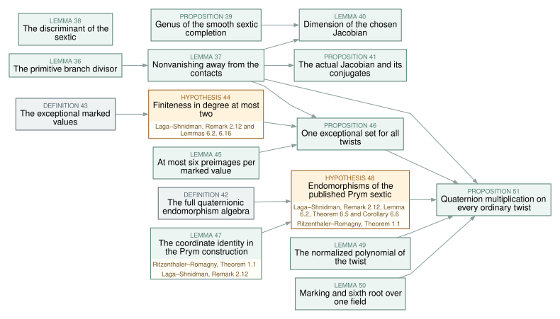

# 3. The Picard sextic and its endomorphisms

[Leitfaden and contents](../proof-map.md) · [Complete diagram](../proof-dependencies.svg)

We now construct the abelian surfaces that will give the height estimate. The six rational contacts become the branch divisor of a pencil of sextics. Away from that divisor the curves are smooth of genus two. The change of equation in [49](#s-49) lets us apply the Prym hypothesis to their Jacobians. Proposition [51](#s-51) obtains quaternion multiplication over one fixed field for every twist outside a single finite set.

For $`t\notin\mathcal C`$, put $`s=5+120/t`$. Work over $`k_0=\mathbb{Q}(\sqrt{-2},\sqrt{-3})`$. Choose $`\rho^2=-3`$ and set $`u=s+\rho`$, $`v=s-\rho`$, $`U=u^6`$, $`V=v^6`$. Write $`A_t^{(d)}`$ for the Jacobian of the smooth completion of

```math
2d y^2=f_{U,V}(x),\quad
       f_{U,V}(x)=(x^2+2x-2)\{4U(2x-1)-Vx^3(x+4)\},\qquad d\in\mathbb{Q}^\times .
```

For $`s=a/b`$ in lowest terms, $`b\gt 0`$, set $`N(s)=ab(a-b)(a+b)(a-3b)(a+3b)`$. The twist used for descent is $`d=e_s`$, the product of the primes $`p\gt 3`$ for which $`v_p(N(s))\equiv2\bmod4`$. Write $`A_t=A_t^{(e_s)}`$. Section 5 proves why this choice works simultaneously at all primes.

The marked Prym parameter is $`j_{\rm P}=U/V`$. A second coordinate, which enters the height estimate, is the rational degree-twelve function

```math
J(t)=-64\,\frac{\{s(s^2-1)(s^2-9)\}^2}{(s^2+3)^6},
      \qquad s=5+120/t.
```

The diagram shows dependencies within this section. The numbered links after each statement also include its prerequisites and applications in other sections.



<a id="s-36"></a>

### Lemma 36. The primitive branch divisor

For $`s=a/b`$ in lowest terms put $`N(s)=ab(a-b)(a+b)(a-3b)(a+3b)`$. At $`s=5+120/t`$ with $`t\notin\mathcal C`$ one has $`N(s)=(b/t)^6\,1920\, F(t)`$.

**Derivation.** Substitute $`5+120/t`$ into the six homogeneous factors and use $`a=bs`$. The identity keeps the contribution of the point at infinity and shows $`N(s)\ne0`$.

[Lean proof](https://github.com/nasqret/z-in-q-lean/blob/95357929cf16cedd3dd1960c11060cb923f5bdca/bounded/QualitativeHeight.lean#L43-L48)

Used in [37](#s-37), [70](reduction.md#s-70), [102](global-height.md#s-102).

<a id="s-37"></a>

### Lemma 37. Nonvanishing away from the contacts

At every noncontact rational input, $`UV(U-V)\ne0`$.

**Derivation.** One has $`UV=(s^2+3)^6`$ and $`U-V=12\rho\,s(s-1)(s+1)(s-3)(s+3)`$. The first factor cannot vanish over $`\mathbb{Q}`$, and [36](#s-36) excludes the zeros of the second.

[Lean proof](https://github.com/nasqret/z-in-q-lean/blob/95357929cf16cedd3dd1960c11060cb923f5bdca/Lean/Lemmas/picard-application/PicardCM.lean#L145-L166)

Prerequisites [36](#s-36).

Used in [40](#s-40), [41](#s-41), [46](#s-46), [51](#s-51), [71](reduction.md#s-71), [84](periods.md#s-84).

<a id="s-38"></a>

### Lemma 38. The discriminant of the sextic

For $`V\ne0`$, the ordinary polynomial discriminant of $`f_{U,V}`$ is $`-2^{22}3^6 U^2V^2(U-V)^6`$.

**Derivation.** Compute the resultant with the derivative using the quadratic and quartic factors, including the sign and the leading coefficient in degree six. Together with [37](#s-37) this proves separability for every allowed twist.

[Lean proof](https://github.com/nasqret/z-in-q-lean/blob/95357929cf16cedd3dd1960c11060cb923f5bdca/picard/PicardDiscriminant.lean#L138-L154)

Used in [71](reduction.md#s-71), [84](periods.md#s-84).

<a id="s-39"></a>

### Proposition 39. Genus of the smooth sextic completion

Over a number field, the projective completion of $`y^2=f(x)`$ for separable $`f`$ of degree six has geometric genus two.

**Derivation.** The two affine charts compute the first cohomology of the structure sheaf. Its additive group is identified with that of $`K^2`$. Restriction to $`\mathbb{Q}`$ and the tower formula for dimensions recover its dimension over $`K`$.

[Lean proof](https://github.com/nasqret/z-in-q-lean/blob/95357929cf16cedd3dd1960c11060cb923f5bdca/Lean/Lemmas/picard-application/PicardSurfaceDimension.lean#L101-L110)

Used in [40](#s-40).

<a id="s-40"></a>

### Lemma 40. Dimension of the chosen Jacobian

The Jacobian of the prescribed squarefree twist at a noncontact input has relative dimension two after every indicated scalar extension of $`k_0=\mathbb{Q}(\sqrt{-2},\sqrt{-3})`$.

**Derivation.** Apply [39](#s-39) to its smooth proper model, identify the dimension of the Jacobian with the genus, and transport smooth relative dimension through its isomorphisms and base change.

[Lean proof](https://github.com/nasqret/z-in-q-lean/blob/95357929cf16cedd3dd1960c11060cb923f5bdca/Lean/Lemmas/picard-application/PicardSurfaceDimension.lean#L171-L176)

Prerequisites [39](#s-39), [37](#s-37).

Used in [61](descent.md#s-61), [69](descent.md#s-69).

<a id="s-41"></a>

### Proposition 41. The actual Jacobian and its conjugates

For every rational $`d\ne0`$ and noncontact $`t`$, every Galois pullback of $`A_t^{(d)}`$ over $`k_0`$ is isomorphic to it as a group scheme.

**Derivation.** Coefficient conjugation either fixes $`U,V`$ or interchanges them. If $`r^2=-2`$, the change $`(x,y)\mapsto(-2/x,2ry/x^3)`$ realizes the exchange. The identity $`x^6 f_{U,V}(-2/x)=-8 f_{V,U}(x)`$ holds on the common chart. The two charts extend the map to the proper curves. Pullback on the Picard varieties gives the asserted isomorphism.

[Lean proof](https://github.com/nasqret/z-in-q-lean/blob/95357929cf16cedd3dd1960c11060cb923f5bdca/Lean/Lemmas/picard-application/PicardDescent.lean#L558-L568)

Prerequisites [37](#s-37).

Used in [53](descent.md#s-53).

<a id="s-42"></a>

### Definition 42. The full quaternionic endomorphism algebra

For $`Y/L`$, a quaternion presentation consists of a division algebra $`D\simeq\mathrm{End}_L^0(Y)`$ generated by $`i,j`$ with $`i^2=-3`$, $`j^2=2`$ and $`ji=-ij`$. Base change on rational endomorphisms to $`\overline{\mathbb{Q}}`$ must also be surjective.

**Use.** Here $`\mathrm{End}^0=\mathbb{Q}\otimes_{\mathbb{Z}}\mathrm{End}`$. Surjectivity is the field-of-definition requirement for the geometric endomorphisms. It enters the descent theorem.

[Lean statement](https://github.com/nasqret/z-in-q-lean/blob/95357929cf16cedd3dd1960c11060cb923f5bdca/Lean/Lemmas/picard-application/QuaternionModel.lean#L12-L23)

Used in [48](#s-48), [53](descent.md#s-53), [57](descent.md#s-57), [60](descent.md#s-60).

<a id="s-43"></a>

### Definition 43. The exceptional marked values

A marked value is split if the smooth degree-six canonical model at that value has a Jacobian over $`\overline{\mathbb{Q}}`$ containing an elliptic abelian subvariety.

**Use.** In dimension two such a subvariety is exactly the obstruction to geometric simplicity. The model, its separability and its subgroup are part of the definition.

[Lean statement](https://github.com/nasqret/z-in-q-lean/blob/95357929cf16cedd3dd1960c11060cb923f5bdca/Lean/Lemmas/picard-application/PicardCM.lean#L242-L243)

Used in [44](#s-44).

<a id="s-44"></a>

### Hypothesis 44. Finiteness in degree at most two

Only finitely many split marked values $`j`$ satisfy $`[\mathbb{Q}(j):\mathbb{Q}]\le2`$.

**Literature.** The intended application combines the Prym description, simplicity up to isogeny, and bounded-degree CM finiteness in Laga–Shnidman, Remark 2.12 and Lemmas 6.2 and 6.16 [Laga](https://doi.org/10.1112/jlms.70347). One must identify the split values of [43](#s-43) with those of their marked line, allowing the exceptional marked values.

[Lean statement](https://github.com/nasqret/z-in-q-lean/blob/95357929cf16cedd3dd1960c11060cb923f5bdca/Lean/Lemmas/picard-application/PicardConclusion.lean#L24-L25) · [Laga–Shnidman, Remark 2.12 and Lemmas 6.2, 6.16](https://doi.org/10.1112/jlms.70347)

Prerequisites [43](#s-43).

Used in [46](#s-46).

<a id="s-45"></a>

### Lemma 45. At most six preimages per marked value

For any injective $`g:\mathbb{Q}\to\mathbb{Q}`$ and finite set $`V_0\subset\overline{\mathbb{Q}}`$, the set of $`t`$ with $`j_{\rm P}(g(t))\in V_0`$ has size at most $`6|V_0|`$.

**Derivation.** At a fixed $`j`$ the equation is $`(x+\rho)^6-j(x-\rho)^6=0`$. This is a nonzero polynomial of degree at most six, including the case $`j=1`$. Injectivity of $`g`$ preserves the bound.

[Lean proof](https://github.com/nasqret/z-in-q-lean/blob/95357929cf16cedd3dd1960c11060cb923f5bdca/Lean/Lemmas/picard-application/PicardCM.lean#L72-L112)

Used in [46](#s-46).

<a id="s-46"></a>

### Proposition 46. One exceptional set for all twists

There is a finite $`T\subset\mathbb{Q}`$ such that, for every noncontact $`t`$ and every rational $`d\ne0`$, $`t\in T`$ if and only if $`A_t^{(d)}`$ geometrically contains an elliptic abelian subvariety. Its size is at most six times the number in [44](#s-44).

**Derivation.** The marked value lies in $`\mathbb{Q}(\rho)`$. Over $`\overline{\mathbb{Q}}`$ all nonzero twists at a fixed parameter give the same canonical fibre up to isomorphism. Apply [45](#s-45) to the bounded-degree split values and transport the elliptic subgroup by this isomorphism.

[Lean proof](https://github.com/nasqret/z-in-q-lean/blob/95357929cf16cedd3dd1960c11060cb923f5bdca/Lean/Lemmas/picard-application/PicardCM.lean#L249-L259)

Prerequisites [44](#s-44), [45](#s-45), [37](#s-37).

Used in [51](#s-51).

<a id="s-47"></a>

### Lemma 47. The coordinate identity in the Prym construction

Write $`f_{\rm RR}`$ for the sextic computed from the coefficient matrix in Ritzenthaler–Romagny's construction and $`f_{\rm P}`$ for the published Prym sextic with parameters $`(a,w^3)`$. For $`aw\ne0`$, $`f_{\rm RR}(wx)=(w^2/a)^2 f_{\rm P}(x)`$.

**Derivation.** Invert the explicit coefficient matrix with determinant $`a`$ and substitute in the three factors [RR](https://doi.org/10.46298/epiga.2018.volume2.3663). This polynomial identity checks the change of model used to interpret [48](#s-48). The geometric isogeny in that hypothesis is supplied separately.

[Lean proof](https://github.com/nasqret/z-in-q-lean/blob/95357929cf16cedd3dd1960c11060cb923f5bdca/Lean/Lemmas/picard-application/PrymCoordinates.lean#L61-L68) · [Ritzenthaler–Romagny, Theorem 1.1](https://doi.org/10.46298/epiga.2018.volume2.3663) · [Laga–Shnidman, Remark 2.12](https://doi.org/10.1112/jlms.70347)

Used in [48](#s-48).

<a id="s-48"></a>

### Hypothesis 48. Endomorphisms of the published Prym sextic

Let $`L/\mathbb{Q}`$ be finite Galois, $`a,w,a^2-4w^3\ne0`$. Suppose $`L`$ contains a primitive cube root of unity and a sixth root of $`16w^3(a^2-4w^3)`$. If the Jacobian of the smooth published sextic is geometrically simple, its $`L`$-model has the full presentation in [42](#s-42).

**Literature.** Laga–Shnidman compute the Prym action and its field of definition in §4.1, Lemma 6.2, Theorem 6.5 and Corollary 6.6. Passing to the genus-two Jacobian uses their Remark 2.12 and the rational isogeny of Ritzenthaler–Romagny, Theorem 1.1 [Laga](https://doi.org/10.1112/jlms.70347) · [RR](https://doi.org/10.46298/epiga.2018.volume2.3663). Entry [47](#s-47) verifies the equation. The transfer of the complete geometric endomorphism algebra is a literature assumption here.

[Lean statement](https://github.com/nasqret/z-in-q-lean/blob/95357929cf16cedd3dd1960c11060cb923f5bdca/Lean/Lemmas/picard-application/PicardPrym.lean#L98-L104) · [Laga–Shnidman, Remark 2.12, Lemma 6.2, Theorem 6.5 and Corollary 6.6](https://doi.org/10.1112/jlms.70347) · [Ritzenthaler–Romagny, Theorem 1.1](https://doi.org/10.46298/epiga.2018.volume2.3663)

Prerequisites [42](#s-42), [47](#s-47).

Used in [51](#s-51).

<a id="s-49"></a>

### Lemma 49. The normalized polynomial of the twist

Put $`\Delta=u^6-v^6`$, $`a_0=2\Delta^2`$, $`w_0=-\Delta v^2`$ and $`\lambda=v^2/d`$. For $`v\Delta d\ne0`$, the published sextic at $`a=\lambda^3 a_0,\ w=\lambda^2 w_0`$ equals $`f_{U,V}/(2d)`$.

**Derivation.** Use the homogeneity of the factors in $`a,w`$ and substitute $`w_0^3=-\Delta^3V`$, $`a_0^2-4w_0^3=4\Delta^3U`$. Equality holds in the polynomial ring, with no residual scaling of $`y`$.

[Lean proof](https://github.com/nasqret/z-in-q-lean/blob/95357929cf16cedd3dd1960c11060cb923f5bdca/Lean/Lemmas/picard-application/PicardPrym.lean#L58-L64)

Used in [51](#s-51).

<a id="s-50"></a>

### Lemma 50. Marking and sixth root over one field

With the parameters of [49](#s-49), suppose $`uv\Delta d\ne0`$ and $`\iota^2=-1`$. Then $`aw(a^2-4w^3)\ne0`$, $`1-a^2/(4w^3)=U/V`$, and $`2\lambda^2\iota\Delta uv`$ is a sixth root of $`16w^3(a^2-4w^3)`$.

**Derivation.** Substitution gives a common factor $`\lambda^{12}`$ on both sides of the sixth-power identity. The marked quotient cancels the weight-six factors.

[Lean proof](https://github.com/nasqret/z-in-q-lean/blob/95357929cf16cedd3dd1960c11060cb923f5bdca/Lean/Lemmas/picard-application/PicardPrym.lean#L68-L91)

Used in [51](#s-51).

<a id="s-51"></a>

### Proposition 51. Quaternion multiplication on every ordinary twist

Over $`L=k_0(\sqrt{-1})`$ there is one finite set of rational parameters outside which every nonzero rational twist at a noncontact input has the quaternion presentation of [42](#s-42).

**Derivation.** Choose $`T`$ from [46](#s-46). On its complement the fibre is geometrically simple. Entry [49](#s-49) identifies its equation with the published sextic and [50](#s-50) provides the splitting element in $`L`$. Since $`(\rho-1)/2`$ is a primitive cube root of unity, [48](#s-48) applies.

[Lean proof](https://github.com/nasqret/z-in-q-lean/blob/95357929cf16cedd3dd1960c11060cb923f5bdca/Lean/Lemmas/picard-application/PicardPrym.lean#L200-L207)

Prerequisites [37](#s-37), [46](#s-46), [48](#s-48), [49](#s-49), [50](#s-50).

Used in [69](descent.md#s-69).
