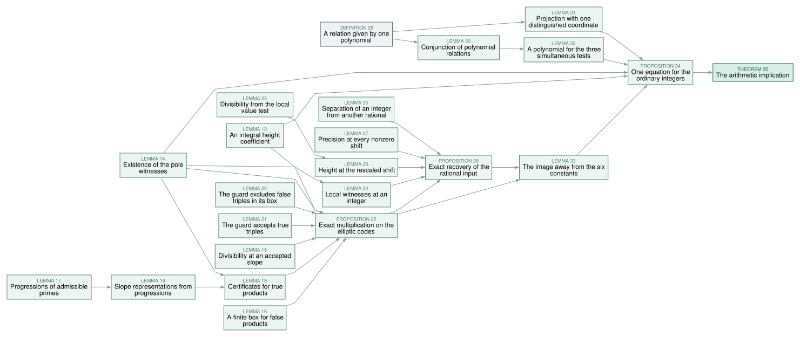

# 2. From height and rank to one equation

[Leitfaden and contents](../proof-map.md) · [Complete diagram](../proof-dependencies.svg)

Assume the rank implication of §1 and the six-contact inequality [2](rank.md#s-2). We first recognize multiplication on the elliptic codes. A false product would have to lie in a fixed finite box, where it can be excluded by one polynomial. We then identify the rational number represented by an accepted code. Both implications use the same integral shift when the local conditions and the real approximation are imposed together. Theorem [35](#s-35) reduces the remaining problem to a uniform height estimate.

Put $`\alpha=\sqrt 2`$, $`d_0=75-53\alpha`$ and let $`P_0`$ be the point on $`y^2=x^3-d_0^2x`$ over $`\mathbb{Q}(\alpha)`$ with coordinates

```math
P_0=\left(\frac{1641-1160\alpha}{8},\frac{-123720+87483\alpha}{32}\right).
```

For $`n\in\mathbb{Z}`$, the code $`\iota(n)\in\mathbb{Q}^5`$ records $`[n]P_0`$. The point at infinity has code $`(1,0,0,0,0)`$. An affine point $`(x_0+x_1\alpha,y_0+y_1\alpha)`$ has code $`(0,x_0,x_1,y_0,y_1)`$ [Glazer](https://github.com/elliotglazer/diophantine-z-q/tree/2358394558aafae202a1ce6d3bd1b536b79ad3d0). Three such codes are the free inputs to the multiplication relation. Its local conditions put any false product inside a finite box, where a polynomial guard excludes it. A second relation recovers the ordinary rational number represented by a code.

The diagram shows dependencies within this section. The numbered links after each statement also include its prerequisites and applications in other sections.



<a id="s-13"></a>

### Lemma 13. An integral height coefficient

Any coefficient satisfying [2](rank.md#s-2) can be replaced by an integer $`m\ge1`$.

**Derivation.** Choose $`m\ge\max(1,C)`$ by the Archimedean property and multiply the inequality $`C\le m`$ by the nonnegative factor $`M(t)^{24}`$.

[Lean proof](https://github.com/nasqret/z-in-q-lean/blob/95357929cf16cedd3dd1960c11060cb923f5bdca/bounded/QualitativeMultiplication.lean#L18-L23)

Prerequisites [2](rank.md#s-2).

Used in [22](#s-22), [34](#s-34).

<a id="s-14"></a>

### Lemma 14. Existence of the pole witnesses

The rank implication for the selected class sums implies the pole-completeness statement used in the arithmetic certificates.

**Derivation.** The proved rank and Rédei comparisons pass from the class-sum test to the selected twists. The upstream pole-completeness argument applies the resulting positive-rank statements. Both twists needed by a certificate are covered.

[Lean proof](https://github.com/nasqret/z-in-q-lean/blob/95357929cf16cedd3dd1960c11060cb923f5bdca/bounded/QualitativeMultiplication.lean#L70-L75)

Prerequisites [12](rank.md#s-12).

Used in [19](#s-19), [22](#s-22), [24](#s-24), [34](#s-34).

<a id="s-15"></a>

### Lemma 15. Divisibility at an accepted slope

Let $`f=n_0n_1-n_2\ne0`$. For a slope satisfying the local certificate, outside a prime set $`S`$ meeting the displayed regularity conditions, $`M_S(t)^{25}\mid f`$. A height bound $`h(t)\le A M_S(t)^{24}`$ with $`A\ge0`$ then gives $`h(t)\le A|f|^{24/25}`$.

**Derivation.** The local congruence forces the twenty-fifth power of every prime in the support to divide $`f`$. Multiply over distinct primes, take absolute values, and raise the resulting inequality to the power $`24/25`$. At $`S=S_{\rm mul}`$ the required inequalities and unit conditions follow from the definition of this set.

[Lean proof](https://github.com/elliotglazer/diophantine-z-q/blob/2358394558aafae202a1ce6d3bd1b536b79ad3d0/ZInQKernel/Multiplication/Soundness/ContactSupport.lean#L49-L65)

Prerequisites [2](rank.md#s-2).

Used in [22](#s-22).

<a id="s-16"></a>

### Lemma 16. A finite box for false products

Suppose $`A\ge1`$, $`f=n_0n_1-n_2\ne0`$, and the three rational quantities in the height certificate for each $`n_i`$ are sums of three slopes of height at most $`A|f|^{24/25}`$. Then $`|n_i|\lt (48A)^{13}`$ for each $`i`$. The code specifies the common nonzero coordinate denominator in that certificate.

**Derivation.** Glazer's finite-box argument bounds the heights of the sums and then the coordinates of $`\iota(n_i)`$. The lower height estimate for the elliptic multiple bounds the largest $`|n_i|`$. Its general coefficient $`A`$ is essential for using [2](rank.md#s-2).

[Lean proof](https://github.com/elliotglazer/diophantine-z-q/blob/2358394558aafae202a1ce6d3bd1b536b79ad3d0/ZInQKernel/Multiplication/Soundness/FiniteBox.lean#L60-L152)

Used in [22](#s-22).

<a id="s-17"></a>

### Lemma 17. Progressions of admissible primes

For every $`k`$ there is an arithmetic progression $`x,x+v,\ldots,x+kv`$, with $`v\gt 0`$, consisting of admissible slope primes larger than every prime in the fixed set $`S_b`$, assuming the dense Green–Tao theorem.

**Derivation.** The admissible primes have positive relative upper density in the primes. Removing the fixed initial segment preserves this property. Apply the dense Green–Tao theorem to the resulting set. Its Lean proof is imported at the application to multiplication.

[Lean proof](https://github.com/elliotglazer/diophantine-z-q/blob/2358394558aafae202a1ce6d3bd1b536b79ad3d0/ZInQKernel/Density/PropDFinal.lean#L28-L29)

Used in [18](#s-18).

<a id="s-18"></a>

### Lemma 18. Slope representations from progressions

The existence of the required prime progressions implies the arithmetic-progression form of the slope representation theorem.

**Derivation.** Apply the simultaneous progression construction to the rational quantities occurring in the certificate. The application of [17](#s-17) supplies its prime hypothesis.

[Lean proof](https://github.com/elliotglazer/diophantine-z-q/blob/2358394558aafae202a1ce6d3bd1b536b79ad3d0/ZInQKernel/Multiplication/Completeness/AP/PropAP.lean#L200-L268)

Prerequisites [17](#s-17).

Used in [19](#s-19).

<a id="s-19"></a>

### Lemma 19. Certificates for true products

For all integers $`a,b`$, the original multiplication relation accepts the codes of $`a,b,ab`$, provided pole witnesses and the slope representations exist.

**Derivation.** Use the pole witnesses and the progression representations to supply the auxiliary certificate. The resulting certificate for the true triple precedes any change in the guard.

[Lean proof](https://github.com/elliotglazer/diophantine-z-q/blob/2358394558aafae202a1ce6d3bd1b536b79ad3d0/ZInQKernel/Multiplication/Completeness/AP/Completeness.lean#L62-L93)

Prerequisites [18](#s-18), [14](#s-14).

Used in [22](#s-22).

<a id="s-20"></a>

### Lemma 20. The guard excludes false triples in its box

For any integral guard parameter $`T`$, if all three indices satisfy $`|n_i|\le T`$ and $`n_0n_1\ne n_2`$, the guard cannot accept the three elliptic codes.

**Derivation.** The tuple itself occurs among the false triples tested by the guard. The guard equivalence therefore rules out this tuple. The constructor hypothesis identifies the polynomial used for this test.

[Lean proof](https://github.com/elliotglazer/diophantine-z-q/blob/2358394558aafae202a1ce6d3bd1b536b79ad3d0/ZInQKernel/Multiplication/Certificate/Guard.lean#L62-L66)

Used in [22](#s-22).

<a id="s-21"></a>

### Lemma 21. The guard accepts true triples

For every guard parameter $`T`$ and all $`a,b\in\mathbb{Z}`$, the guard accepts the codes of $`a,b,ab`$.

**Derivation.** None of the false triples in the finite box equals this triple. Injectivity of the elliptic coding proves the asserted guard relation.

[Lean proof](https://github.com/elliotglazer/diophantine-z-q/blob/2358394558aafae202a1ce6d3bd1b536b79ad3d0/ZInQKernel/Multiplication/Certificate/Guard.lean#L46-L59)

Used in [22](#s-22).

<a id="s-22"></a>

### Proposition 22. Exact multiplication on the elliptic codes

Under the height and pole hypotheses, take $`m\ge1`$ as in [13](#s-13) and $`T=(48m)^{13}`$. With this guard the multiplication relation on $`\mathbb{Q}^5`$ accepts precisely $`(\iota(a),\iota(b),\iota(ab))`$.

**Derivation.** For a false triple, [15](#s-15) bounds each slope and [16](#s-16) puts its indices inside the guard. This contradicts [20](#s-20). For a true triple, retain the certificate furnished by [19](#s-19) and replace its guard witness using [21](#s-21).

[Lean proof](https://github.com/nasqret/z-in-q-lean/blob/95357929cf16cedd3dd1960c11060cb923f5bdca/bounded/QualitativeMultiplication.lean#L78-L103)

Prerequisites [13](#s-13), [14](#s-14), [15](#s-15), [16](#s-16), [19](#s-19), [20](#s-20), [21](#s-21).

Used in [28](#s-28), [33](#s-33).

<a id="s-23"></a>

### Lemma 23. Divisibility from the local value test

Write $`F(n)=\prod_{c\in\mathcal C}(n-c)`$. If the local test accepts $`(n,\kappa,t)`$, its contact-prime product outside the primes up to $`324`$ divides $`\kappa F(n)`$ as an integer.

**Derivation.** For each odd contact prime outside the fixed set the tested local conditions imply divisibility. The contact product is squarefree, so the primewise statements multiply.

[Lean proof](https://github.com/elliotglazer/diophantine-z-q/blob/2358394558aafae202a1ce6d3bd1b536b79ad3d0/ZInQKernel/Assembly/Local/TestDivisibility.lean#L381-L394)

Used in [26](#s-26).

<a id="s-24"></a>

### Lemma 24. Local witnesses at an integer

For $`n\in\mathbb{Z}`$ with $`n\notin\mathcal C`$, pole completeness implies that there is a nonzero integral shift $`\kappa`$ at which the local test accepts $`(n,\kappa,n)`$.

**Derivation.** The local test constructs its simultaneous witnesses using pole completeness. The quantifier chooses the shift for this integer. The precision test uses the same shift.

[Lean proof](https://github.com/elliotglazer/diophantine-z-q/blob/2358394558aafae202a1ce6d3bd1b536b79ad3d0/ZInQKernel/Assembly/Local/TestCompleteness.lean#L35-L113)

Prerequisites [14](#s-14).

Used in [28](#s-28).

<a id="s-25"></a>

### Lemma 25. Separation of an integer from another rational

If $`h(t)\le B`$ and $`|t-n|\lt \exp(-B)`$ for $`t\in\mathbb{Q}`$, $`n\in\mathbb{Z}`$, then $`t=n`$.

**Derivation.** Write $`t=a/b`$ in lowest terms. If $`a-bn\ne0`$, then $`|t-n|\ge 1/b\ge \exp(-h(t))`$, which contradicts the strict inequality.

[Lean proof](https://github.com/elliotglazer/diophantine-z-q/blob/2358394558aafae202a1ce6d3bd1b536b79ad3d0/lean/ZInQ/RationalSeparation.lean#L93-L98)

Used in [28](#s-28).

<a id="s-26"></a>

### Lemma 26. Height at the rescaled shift

If the local test accepts and $`n`$ is outside the contacts, the height of $`t`$ is bounded by the precision program's bound evaluated at $`(n,m\kappa)`$, where $`m`$ is an integral coefficient in [2](rank.md#s-2).

**Derivation.** The set $`S_{\rm mul}`$ contains the small primes excluded in [23](#s-23). The support product therefore divides $`|\kappa F(n)|`$. In the precision bound the shift is multiplied by $`m`$, and the coefficient of the fixed bound is at least one.

[Lean proof](https://github.com/nasqret/z-in-q-lean/blob/95357929cf16cedd3dd1960c11060cb923f5bdca/bounded/QualitativePrecision.lean#L136-L155)

Prerequisites [2](rank.md#s-2), [23](#s-23).

Used in [28](#s-28).

<a id="s-27"></a>

### Lemma 27. Precision at every nonzero shift

Whenever multiplication is exact for the guard $`T`$, the precision test accepts $`(\iota(n),\iota(\kappa),n)`$ for every noncontact $`n`$ and every nonzero $`\kappa`$.

**Derivation.** Choose the elliptic approximation index after the required precision is known, and then choose a ratio of elliptic coordinates close enough to $`n`$. Quantification over every nonzero shift will allow the local and real witnesses to coexist.

[Lean proof](https://github.com/nasqret/z-in-q-lean/blob/95357929cf16cedd3dd1960c11060cb923f5bdca/bounded/QualitativePrecision.lean#L112-L133)

Used in [28](#s-28).

<a id="s-28"></a>

### Proposition 28. Exact recovery of the rational input

Assume exact multiplication for $`T`$, pole completeness and [2](rank.md#s-2) with $`m\ge1`$. A code $`N`$ and a rational $`t`$ pass the local, scalar and precision tests jointly if and only if $`N=\iota(n)`$ and $`t=n`$ for an integer outside the contacts.

**Derivation.** In the forward direction scalar multiplication changes $`\kappa`$ to $`m\kappa`$. Precision gives strict distance less than the exponential of the negative bound in [26](#s-26), so [25](#s-25) applies. In the reverse direction use [24](#s-24) first, then [27](#s-27) at that same nonzero $`m\kappa`$.

[Lean proof](https://github.com/nasqret/z-in-q-lean/blob/95357929cf16cedd3dd1960c11060cb923f5bdca/bounded/QualitativePrecision.lean#L159-L184)

Prerequisites [24](#s-24), [25](#s-25), [26](#s-26), [27](#s-27), [22](#s-22).

Used in [33](#s-33).

<a id="s-29"></a>

### Definition 29. A relation given by one polynomial

A relation on rational coordinates has a polynomial representation if it is the existential projection of the zero set of one integer polynomial, with a finite list of rational witnesses.

**Use.** The disjoint union in the variable index keeps the original coordinates separate from the existential ones.

[Lean statement](https://github.com/nasqret/z-in-q-lean/blob/95357929cf16cedd3dd1960c11060cb923f5bdca/bounded/FinitePolynomial.lean#L14-L16)

Used in [30](#s-30), [31](#s-31).

<a id="s-30"></a>

### Lemma 30. Conjunction of polynomial relations

The conjunction of two relations with polynomial representations again has a polynomial representation.

**Derivation.** Rename the auxiliary coordinates into disjoint sets. Over the ordered field $`\mathbb{Q}`$, $`P^2+Q^2=0`$ is equivalent to $`P=Q=0`$.

[Lean proof](https://github.com/nasqret/z-in-q-lean/blob/95357929cf16cedd3dd1960c11060cb923f5bdca/bounded/FinitePolynomial.lean#L54-L78)

Prerequisites [29](#s-29).

Used in [32](#s-32).

<a id="s-31"></a>

### Lemma 31. Projection with one distinguished coordinate

For a polynomial relation on one visible coordinate and finitely many further coordinates, projecting away those coordinates gives a polynomial in $`k+1`$ variables for some $`k`$, with the distinguished coordinate first.

**Derivation.** Combine the projected coordinates with the old witnesses and reindex the finite set. Renaming the variables preserves evaluation.

[Lean proof](https://github.com/nasqret/z-in-q-lean/blob/95357929cf16cedd3dd1960c11060cb923f5bdca/bounded/FinitePolynomial.lean#L82-L106)

Prerequisites [29](#s-29).

Used in [34](#s-34).

<a id="s-32"></a>

### Lemma 32. A polynomial for the three simultaneous tests

For each fixed $`T,m`$ the conjunction of the local value test, multiplication by the scalar $`m`$, and the precision test has a polynomial representation on three elliptic codes and one rational input.

**Derivation.** Pull the three polynomial templates back to their respective blocks of coordinates. The compiler for the precision program gives the last template. Apply [30](#s-30) twice, retaining the common code variables and choosing the auxiliary witnesses independently.

[Lean proof](https://github.com/nasqret/z-in-q-lean/blob/95357929cf16cedd3dd1960c11060cb923f5bdca/bounded/IntegerPolynomial.lean#L48-L63)

Prerequisites [30](#s-30).

Used in [34](#s-34).

<a id="s-33"></a>

### Lemma 33. The image away from the six constants

With the guard $`(48m)^{13}`$ and the height and pole hypotheses, the existential projection of the three tests consists exactly of the noncontact integers.

**Derivation.** Decode an accepting triple by [28](#s-28). Conversely insert $`\iota(n)`$ and the two shifts furnished by the reverse implication. Pack the three codes into fifteen rational coordinates.

[Lean proof](https://github.com/nasqret/z-in-q-lean/blob/95357929cf16cedd3dd1960c11060cb923f5bdca/bounded/IntegerPolynomial.lean#L68-L80)

Prerequisites [28](#s-28), [22](#s-22).

Used in [34](#s-34).

<a id="s-34"></a>

### Proposition 34. One equation for the ordinary integers

A uniform six-contact bound and the selected class-sum rank implication imply [1](rank.md#s-1).

**Derivation.** Project the joint polynomial by [31](#s-31). Multiply it by $`T(T+15)(T+20)(T+24)(T+30)(T+60)`$, where $`T`$ here denotes the visible polynomial variable. Its six zeros are integers and can use the all-zero witness tuple. Off those zeros [33](#s-33) proves both implications.

[Lean proof](https://github.com/nasqret/z-in-q-lean/blob/95357929cf16cedd3dd1960c11060cb923f5bdca/bounded/IntegerPolynomial.lean#L92-L112)

Prerequisites [1](rank.md#s-1), [13](#s-13), [14](#s-14), [31](#s-31), [32](#s-32), [33](#s-33).

Used in [35](#s-35).

<a id="s-35"></a>

### Theorem 35. The arithmetic implication

If [2](rank.md#s-2) holds for some real $`C`$, and the two analytic hypotheses [5](rank.md#s-5) and [6](rank.md#s-6) hold, then $`\mathbb{Z}`$ is Diophantine over $`\mathbb{Q}`$ in the sense of [1](rank.md#s-1).

**Derivation.** Apply [12](rank.md#s-12) to obtain the rank hypothesis of [34](#s-34). The remaining sections establish the needed uniform height bound from arithmetic geometry.

[Lean proof](https://github.com/nasqret/z-in-q-lean/blob/95357929cf16cedd3dd1960c11060cb923f5bdca/bounded/IntegerPolynomial.lean#L116-L119)

Prerequisites [34](#s-34), [12](rank.md#s-12).

Used in [107](global-height.md#s-107).
