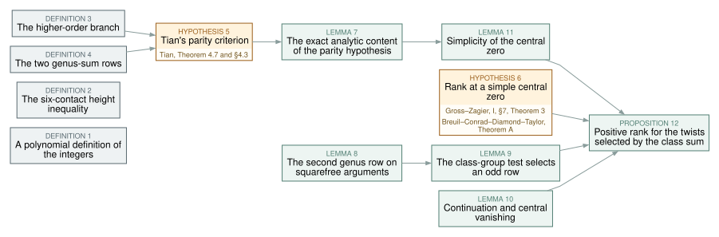

# 1. The target and the rank criterion

[Leitfaden and contents](../proof-map.md) · [Complete diagram](../proof-dependencies.svg)

The first arithmetic input is a point of infinite order on each twist selected by the class-group congruence. Two steps give it. The congruence makes the second of Tian's unordered genus sums odd. The functional equation gives central vanishing, while the parity hypothesis excludes higher order. Proposition [12](#s-12) then follows from the rank theorem at a simple central zero.

Let $`\mathbb{Q}`$ carry its usual ordering. An integer is viewed in $`\mathbb{Q}`$ by the canonical embedding. For a positive squarefree $`d\equiv5\pmod8`$, put $`E_d:y^2=x^3-d^2x`$. All orders of vanishing in this section refer to the arithmetic $`L`$-function at $`s=1`$.

The diagram shows dependencies within this section. The numbered links after each statement also include its prerequisites and applications in other sections.



<a id="s-1"></a>

### Definition 1. A polynomial definition of the integers

There exist $`k\in\mathbb{N}`$ and a polynomial $`P\in\mathbb{Z}[T,X_1,\ldots,X_k]`$ such that, for every $`t\in\mathbb{Q}`$,

```math
\bigl(\exists\,w\in\mathbb{Q}^k,\ P(t,w)=0\bigr)
            \quad\Longleftrightarrow\quad t\in\mathbb{Z} .
```

**Use.** The quantifiers choose a single polynomial before the rational input is given. Coordinate zero holds $`t`$. The remaining $`k`$ coordinates range independently over $`\mathbb{Q}`$.

[Lean statement](https://github.com/nasqret/z-in-q-lean/blob/95357929cf16cedd3dd1960c11060cb923f5bdca/bounded/IntegerPolynomial.lean#L15-L18)

Used in [34](polynomial.md#s-34).

<a id="s-2"></a>

### Definition 2. The six-contact height inequality

Set $`\mathcal C=\{0,-15,-20,-24,-30,-60\}`$. For $`t=a/b`$ in lowest terms with $`b\gt 0`$, let $`h(t)=\log\max(|a|,b)`$. Let $`S_{\rm mul}`$ be the fixed set of primes in the multiplication certificate. Write $`M(t)`$ for the product of the primes $`p\notin S_{\rm mul}`$ for which $`v_p(t-c)`$ is positive and odd for some $`c\in\mathcal C`$. The height assertion with coefficient $`C`$ is $`h(t)\le C M(t)^{24}`$ on $`\mathbb{Q}\setminus\mathcal C`$.

**Use.** The exponent $`24`$ will enter the arithmetic comparison with a divisibility of exponent $`25`$. The coefficient is allowed to vary with the defining polynomial.

[Lean statement](https://github.com/nasqret/z-in-q-lean/blob/95357929cf16cedd3dd1960c11060cb923f5bdca/bounded/QualitativeMultiplication.lean#L12-L13)

Used in [13](polynomial.md#s-13), [15](polynomial.md#s-15), [26](polynomial.md#s-26), [105](global-height.md#s-105).

<a id="s-3"></a>

### Definition 3. The higher-order branch

For each selected $`d`$, put the analytic numerator equal to zero if some arithmetic continuation of $`E_d`$ has order at least two at $`1`$. Elsewhere use the chosen lower-order value.

**Use.** The rank argument requires only this prescribed zero branch. The function on the complementary branch is quantified existentially in [5](#s-5).

[Lean statement](https://github.com/nasqret/z-in-q-lean/blob/95357929cf16cedd3dd1960c11060cb923f5bdca/bounded/PublishedGenusRows.lean#L211-L214)

Used in [5](#s-5).

<a id="s-4"></a>

### Definition 4. The two genus-sum rows

For squarefree $`d\equiv5\bmod8`$, if either of the two weighted rows is odd, the rational number $`\mathcal L(d)/2^{\rho(d)}`$ is an odd integer.

**Use.** The first row has one distinguished factor congruent to $`5`$ and the others congruent to $`1`$ modulo $`8`$. On the disjoint second row the distinguished factors are $`7`$ and $`3`$ modulo $`8`$. In each case an unordered factorization is counted once.

[Lean statement](https://github.com/nasqret/z-in-q-lean/blob/95357929cf16cedd3dd1960c11060cb923f5bdca/bounded/PublishedGenusRows.lean#L228-L230)

Used in [5](#s-5).

<a id="s-5"></a>

### Hypothesis 5. Tian's parity criterion

For positive squarefree $`d\equiv5\pmod8`$, an odd value of either of Tian's two genus sums forces the normalized analytic value to be odd as an integer. The formal predicate fixes the normalized numerator at zero whenever a continuation has order at least two. Its other values and its power-of-two denominator are existential.

**Literature.** Tian, Theorem 4.7, with the definition of the analytic value on pp. 57–58 [Tian](https://intlpress.com/site/pub/files/_fulltext/journals/iccm/2017/0005/0001/ICCM-2017-0005-0001-a003.pdf). The sums are over unordered factorizations. The change $`(x,y)\mapsto(dx,d^2y)`$ takes $`dy^2=x^3-x`$ to $`E_d`$. This preserves the arithmetic $`L`$-function. The full normalization used in the code is linked from the definition.

[Lean statement](https://github.com/nasqret/z-in-q-lean/blob/95357929cf16cedd3dd1960c11060cb923f5bdca/bounded/PublishedGenusRows.lean#L234-L235) · [Tian, Theorem 4.7 and §4.3](https://intlpress.com/site/pub/files/_fulltext/journals/iccm/2017/0005/0001/ICCM-2017-0005-0001-a003.pdf#page=8)

Prerequisites [3](#s-3), [4](#s-4).

Used in [7](#s-7), [113](global-height.md#s-113).

<a id="s-6"></a>

### Hypothesis 6. Rank at a simple central zero

For a nonsingular elliptic curve $`E/\mathbb{Q}`$ and a continuation $`F`$ of its arithmetic $`L`$-function, $`\mathrm{ord}_1(F)=1`$ implies that $`E(\mathbb{Q})`$ contains a point of infinite order.

**Literature.** This is the predicate abbreviated by `SimpleZeroRank` in the final theorem. Gross–Zagier give the positive-rank consequence of a simple central zero for modular elliptic curves. Every elliptic curve over $`\mathbb{Q}`$ is modular [GrossZagier](https://doi.org/10.1007/BF01388809) · [Modularity](https://math.stanford.edu/~conrad/papers/tswfinal.pdf). Tian's Theorem 2.5 also gives the rank implication on the selected congruent-number curves [Tian](https://intlpress.com/site/pub/files/_fulltext/journals/iccm/2017/0005/0001/ICCM-2017-0005-0001-a003.pdf).

[Lean statement](https://github.com/elliotglazer/diophantine-z-q/blob/2358394558aafae202a1ce6d3bd1b536b79ad3d0/ZInQKernel/Hypotheses/CR3Literature.lean#L70-L72) · [Gross–Zagier, I, §7, Theorem 3](https://math.bu.edu/people/svh/GZ1.pdf#page=7) · [Breuil–Conrad–Diamond–Taylor, Theorem A](https://math.stanford.edu/~conrad/papers/tswfinal.pdf#page=1)

Used in [12](#s-12), [113](global-height.md#s-113).

<a id="s-7"></a>

### Lemma 7. The exact analytic content of the parity hypothesis

The predicate in [5](#s-5) is equivalent to exclusion of order at least two for every continuation attached to a squarefree $`d\equiv5\pmod8`$ with an odd genus row.

**Derivation.** In the forward direction the higher-order branch gives zero, which cannot be an odd integer. Conversely, once that branch is excluded on odd rows, take the lower-order numerator to be $`1`$ and the normalization exponent to be $`0`$.

[Lean proof](https://github.com/nasqret/z-in-q-lean/blob/95357929cf16cedd3dd1960c11060cb923f5bdca/bounded/BoundedFromGenus.lean#L23-L41)

Prerequisites [5](#s-5).

Used in [11](#s-11).

<a id="s-8"></a>

### Lemma 8. The second genus row on squarefree arguments

For squarefree $`d\equiv5\pmod8`$, Tian's unordered second-row sum equals the class-group coefficient indexed by the second row in the arithmetic construction.

**Derivation.** Squarefreeness removes repeated factors from the multiset. The factors greater than one have respective residues $`7,3,1,\ldots,1`$ modulo $`8`$. The weight is the product of the sizes of the doubled ideal class groups of $`\mathbb{Q}(\sqrt{-e})`$ for the factors $`e`$. The two distinguished residues identify their factors uniquely.

[Lean proof](https://github.com/nasqret/z-in-q-lean/blob/95357929cf16cedd3dd1960c11060cb923f5bdca/bounded/BoundedFromGenus.lean#L15-L18)

Used in [9](#s-9).

<a id="s-9"></a>

### Lemma 9. The class-group test selects an odd row

For squarefree $`d\equiv5\pmod8`$, the class-sum congruence in the multiplication construction implies that at least one of the two published genus rows is odd.

**Derivation.** Use the second row. Its integer weight has the same reduction modulo two as the prescribed class sum. Evenness would give $`0=1`$ in $`\mathbb{Z}/2\mathbb{Z}`$.

[Lean proof](https://github.com/nasqret/z-in-q-lean/blob/95357929cf16cedd3dd1960c11060cb923f5bdca/bounded/BoundedFromGenus.lean#L69-L77)

Prerequisites [8](#s-8).

Used in [12](#s-12).

<a id="s-10"></a>

### Lemma 10. Continuation and central vanishing

Every selected $`E_d`$ has an entire continuation of its arithmetic $`L`$-function which vanishes at $`1`$.

**Derivation.** The formal Gaussian Hecke-series theorem gives a continuation and the functional equation. Its sign is $`-1`$ for $`d\equiv5\pmod 8`$. Substitution at the centre gives the zero.

[Lean proof](https://github.com/nasqret/z-in-q-lean/blob/95357929cf16cedd3dd1960c11060cb923f5bdca/bounded/BoundedFromGenus.lean#L49-L53)

Used in [12](#s-12).

<a id="s-11"></a>

### Lemma 11. Simplicity of the central zero

Assume [5](#s-5). If either genus row is odd, every arithmetic continuation of $`E_d`$ has a simple zero at $`1`$.

**Derivation.** The order is at most one by [7](#s-7). The sign in the functional equation forces central vanishing for the given continuation. Analyticity then excludes order zero.

[Lean proof](https://github.com/nasqret/z-in-q-lean/blob/95357929cf16cedd3dd1960c11060cb923f5bdca/bounded/BoundedFromGenus.lean#L56-L63)

Prerequisites [7](#s-7).

Used in [12](#s-12).

<a id="s-12"></a>

### Proposition 12. Positive rank for the twists selected by the class sum

Assume [5](#s-5) and [6](#s-6). A positive squarefree $`d\equiv5\pmod8`$ passing the class-group test gives a point of infinite order on $`E_d`$.

**Derivation.** Apply [9](#s-9) and choose the continuation in [10](#s-10). Its zero is simple by [11](#s-11). The coefficient $`-d^2`$ is nonzero, so the curve is nonsingular and [6](#s-6) applies.

[Lean proof](https://github.com/nasqret/z-in-q-lean/blob/95357929cf16cedd3dd1960c11060cb923f5bdca/bounded/BoundedFromGenus.lean#L95-L97)

Prerequisites [6](#s-6), [9](#s-9), [10](#s-10), [11](#s-11).

Used in [14](polynomial.md#s-14), [35](polynomial.md#s-35).
