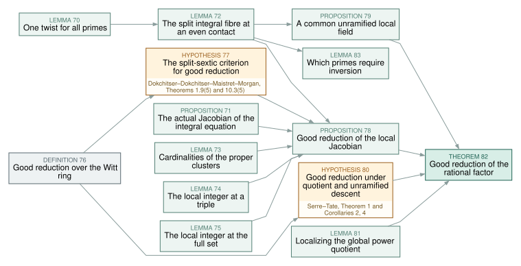

# 5. Good reduction outside the odd contacts

[Leitfaden and contents](../proof-map.md) · [Complete diagram](../proof-dependencies.svg)

We determine which primes may be bad for the rational variety obtained by descent. A single twist controls the parity of the cluster invariants at every prime. We identify the integral sextic with the actual Jacobian, verify the cluster criterion on it, and transfer good reduction to the rational quotient. Theorem [82](#s-82) permits a fixed finite set of exceptions depending on the common field.

Continue with the twist $`A_t=A_t^{(e_s)}`$ of §3. A cluster is a nonempty intersection of the set of roots with a closed valuation disc. For a cluster $`S`$, the integer $`\nu_S`$ is the valuation of the leading coefficient plus the sum, over roots $`r`$, of the depths of the smallest clusters containing $`S`$ and $`r`$.

The diagram shows dependencies within this section. The numbered links after each statement also include its prerequisites and applications in other sections.



<a id="s-70"></a>

### Lemma 70. One twist for all primes

The exponent of a prime $`p`$ in $`e_s`$ is $`1`$ precisely when $`p\gt 3`$ and $`v_p(|N(s)|)\equiv2\bmod4`$, and is $`0`$ otherwise, using the formal factorization convention at zero.

**Derivation.** The twist is the product of the indicated distinct prime divisors. In particular it is positive and squarefree. At a smooth fibre [36](picard.md#s-36) ensures that its branch integer is nonzero.

[Lean proof](https://github.com/nasqret/z-in-q-lean/blob/95357929cf16cedd3dd1960c11060cb923f5bdca/picard/PrimitiveTwist.lean#L34-L50)

Prerequisites [36](picard.md#s-36).

Used in [72](#s-72).

<a id="s-71"></a>

### Proposition 71. The actual Jacobian of the integral equation

Write $`s=a/b`$. For every integer $`e\ne0`$ and embedding of $`k_0`$ into the stated field, the scalar extension of $`A_t^{(e)}`$ is isomorphic to the Jacobian of the smooth completion of

```math
Y^2=2e\,f_{(a+\rho b)^6,(a-\rho b)^6}(x).
```

**Derivation.** Replacing $`u,v`$ by $`bu,bv`$ multiplies the sextic by $`b^6`$. The substitution $`Y=2eb^3y`$ gives the integral equation. Compatibility of smooth completion, change of ordinate and passage to the Jacobian gives the isomorphism.

[Lean proof](https://github.com/nasqret/z-in-q-lean/blob/95357929cf16cedd3dd1960c11060cb923f5bdca/Lean/Lemmas/picard-application/PicardLocalization.lean#L280-L311)

Prerequisites [37](picard.md#s-37), [38](picard.md#s-38).

Used in [78](#s-78), [95](periods.md#s-95).

<a id="s-72"></a>

### Lemma 72. The split integral fibre at an even contact

If $`p\gt 3`$, $`N(s)\ne0`$ and $`v_p(N(s))`$ is even, the roots of the integral twist admit one of the classified configurations over a finite unramified extension. The prescribed square root of $`-3`$ can be used up to sign.

**Derivation.** Hensel lifting gives distinct roots in the unit case. In a chart with one nonunit parameter of order $`r\gt 0`$ there is one triple of depth $`2r`$. When the two parameters are units and the difference of their sixth powers has order $`2r\gt 0`$, there are two triples of depth $`r`$. The reciprocal chart handles the other nonunit parameter. The roots and their pairwise valuations determine all discs meeting the root set.

[Lean proof](https://github.com/nasqret/z-in-q-lean/blob/95357929cf16cedd3dd1960c11060cb923f5bdca/picard/LocalSupport.lean#L984-L1009)

Prerequisites [70](#s-70).

Used in [78](#s-78), [79](#s-79), [83](#s-83).

<a id="s-73"></a>

### Lemma 73. Cardinalities of the proper clusters

Every cluster strictly below the full set in each of the finite trees just described has odd cardinality.

**Derivation.** Enumerate the two possible triple rows and the singleton leaves of the six-root tree. Every nonempty cluster strictly below the full root set has size one or three.

[Lean proof](https://github.com/nasqret/z-in-q-lean/blob/95357929cf16cedd3dd1960c11060cb923f5bdca/picard/LocalSupport.lean#L568)

Used in [78](#s-78).

<a id="s-74"></a>

### Lemma 74. The local integer at a triple

For a triple row of depth $`m`$ with top depth zero, $`\nu_{\rm row}=v(c_f)+3m`$, where $`c_f`$ is the leading coefficient.

**Derivation.** The three roots in the row contribute $`m`$ each. The other three meet the row at the top, so their contribution vanishes.

[Lean proof](https://github.com/nasqret/z-in-q-lean/blob/95357929cf16cedd3dd1960c11060cb923f5bdca/picard/LocalSupport.lean#L604-L611)

Used in [78](#s-78).

<a id="s-75"></a>

### Lemma 75. The local integer at the full set

For the full cluster in the same configurations, $`\nu_{\rm top}=v(c_f)`$.

**Derivation.** Every root meets the full cluster at depth zero. This also gives the required parity whenever the full cluster is principal.

[Lean proof](https://github.com/nasqret/z-in-q-lean/blob/95357929cf16cedd3dd1960c11060cb923f5bdca/picard/LocalSupport.lean#L613-L614)

Used in [78](#s-78).

<a id="s-76"></a>

### Definition 76. Good reduction over the Witt ring

For a finite residue field $`k`$ of characteristic $`p`$, an abelian variety over $`\mathrm{Frac}W(k)`$ has good reduction in this sense if it is isomorphic to the generic fibre of an abelian scheme over $`W(k)`$.

**Use.** The isomorphism on generic fibres is part of the condition, so the local model supplied by the split-sextic criterion can later be compared to the global Jacobian.

[Lean statement](https://github.com/nasqret/z-in-q-lean/blob/95357929cf16cedd3dd1960c11060cb923f5bdca/picard/PicardAssembly.lean#L99-L101)

Used in [77](#s-77), [80](#s-80).

<a id="s-77"></a>

### Hypothesis 77. The split-sextic criterion for good reduction

Let $`p`$ be odd and $`K`$ a finite unramified extension of $`\mathbb{Q}_p`$. Let a separable sextic with integral coefficients split with six integral roots. If every nonempty cluster strictly below the full root set has odd size and $`\nu_S`$ is even for every principal cluster, the Jacobian of the smooth completion has good reduction over $`K`$.

**Literature.** Dokchitser–Dokchitser–Maistret–Morgan, Theorem 1.9(5), equivalently Theorem 10.3(5) [DDMM](https://doi.org/10.1007/s00208-021-02319-y). Splitting supplies the unramified root-field condition. In Lean the discs are recovered from the six labelled roots. The conclusion gives an abelian scheme over the Witt ring with the specified generic fibre.

[Lean statement](https://github.com/nasqret/z-in-q-lean/blob/95357929cf16cedd3dd1960c11060cb923f5bdca/Lean/Lemmas/picard-application/PicardGoodReduction.lean#L90-L102) · [Dokchitser–Dokchitser–Maistret–Morgan, Theorems 1.9(5) and 10.3(5)](https://doi.org/10.1007/s00208-021-02319-y)

Prerequisites [76](#s-76).

Used in [78](#s-78), [113](global-height.md#s-113).

<a id="s-78"></a>

### Proposition 78. Good reduction of the local Jacobian

The split integral model with the computed root and parity data satisfies [77](#s-77). With the stated identification of generic fibres this gives good reduction for the localized Jacobian.

**Derivation.** The root distances identify the actual cluster tree. In the one-triple chart the triple has $`\nu=6r`$. In the two-triple case the twist adds the parity of $`r`$ to the leading term, making $`v(c_f)+3r`$ even. The two complementary triples make the top nonprincipal. Use [73](#s-73)–[75](#s-75), then transport the smooth-completion conclusion across the comparison isomorphism.

[Lean proof](https://github.com/nasqret/z-in-q-lean/blob/95357929cf16cedd3dd1960c11060cb923f5bdca/Lean/Lemmas/picard-application/PicardGoodReduction.lean#L174-L199)

Prerequisites [77](#s-77), [72](#s-72), [73](#s-73), [74](#s-74), [75](#s-75), [71](#s-71).

Used in [82](#s-82).

<a id="s-79"></a>

### Proposition 79. A common unramified local field

Fix a normal number field $`M`$ and $`\delta\in M`$ with $`\delta^2=-3`$. Outside the prime divisors of a single nonzero integer depending on $`M`$, the finite unramified field carrying the six roots can be enlarged to contain an embedded copy of $`M`$ which takes $`\delta`$ to the chosen root.

**Derivation.** Choose an integral primitive generator and omit the primes dividing its discriminant and the required denominators. Hensel lift a root in a finite residue extension and use normality to match the distinguished radical. Extending the Witt vectors preserves the six labelled roots.

[Lean proof](https://github.com/nasqret/z-in-q-lean/blob/95357929cf16cedd3dd1960c11060cb923f5bdca/Lean/Lemmas/picard-application/CommonWittField.lean#L206-L233)

Prerequisites [72](#s-72).

Used in [82](#s-82).

<a id="s-80"></a>

### Hypothesis 80. Good reduction under quotient and unramified descent

For each $`p`$, good reduction over a finite unramified extension of $`\mathbb{Q}_p`$ passes to a surjective abelian quotient. If an abelian variety over $`\mathbb{Q}_p`$ acquires good reduction over that extension, it already has good reduction over $`\mathbb{Q}_p`$.

**Literature.** Serre–Tate, Theorem 1 and its corollaries [SerreTate](https://wstein.org/papers/bib/Serre-Tate-Good_Reduction_of_Abelian_Varieties.pdf). For an auxiliary prime $`\ell\ne p`$, unramifiedness of the rational Tate module passes to a quotient. Unramified base extension preserves the inertia condition.

[Lean statement](https://github.com/nasqret/z-in-q-lean/blob/95357929cf16cedd3dd1960c11060cb923f5bdca/picard/PicardAssembly.lean#L106-L112) · [Serre–Tate, Theorem 1 and Corollaries 2, 4](https://wstein.org/papers/bib/Serre-Tate-Good_Reduction_of_Abelian_Varieties.pdf)

Prerequisites [76](#s-76).

Used in [82](#s-82), [113](global-height.md#s-113).

<a id="s-81"></a>

### Lemma 81. Localizing the global power quotient

Suppose a power of $`A_t`$ maps surjectively over $`M`$ to the base change of a rational group scheme $`B`$. Under every embedding of $`M`$ into the indicated finite unramified $`p`$-adic field, the corresponding local power maps surjectively to the corresponding base change of $`B`$.

**Derivation.** Base change preserves scheme-theoretic surjectivity. Identify the source through the isomorphisms for iterated base change and products. The two maps from $`\mathbb{Q}`$ agree, which identifies the target.

[Lean proof](https://github.com/nasqret/z-in-q-lean/blob/95357929cf16cedd3dd1960c11060cb923f5bdca/Lean/Lemmas/picard-application/PicardPolynomial.lean#L98-L125)

Used in [82](#s-82), [110](global-height.md#s-110).

<a id="s-82"></a>

### Theorem 82. Good reduction of the rational factor

For a fixed normal $`M`$ there is a finite set $`S_0`$ of primes containing $`2,3`$. Outside $`S_0`$, the cluster condition and the local power maps imply good reduction of the rational abelian variety $`B`$ over $`\mathbb{Q}_p`$.

**Derivation.** Work over the common field of [79](#s-79). Entry [78](#s-78) gives good reduction for the Jacobian and hence for its positive power. Use the quotient clause in [80](#s-80) there, then its descent clause over $`\mathbb{Q}_p`$. In the final application the maps for each local embedding come from [81](#s-81).

[Lean proof](https://github.com/nasqret/z-in-q-lean/blob/95357929cf16cedd3dd1960c11060cb923f5bdca/Lean/Lemmas/picard-application/CommonWittReduction.lean#L79-L90)

Prerequisites [78](#s-78), [79](#s-79), [80](#s-80), [81](#s-81).

Used in [110](global-height.md#s-110).

<a id="s-83"></a>

### Lemma 83. Which primes require inversion

Let $`S_0`$ contain $`2,3`$ and let $`N(s)\ne0`$. Outside $`S_0`$ and the primes of odd valuation on $`N(s)`$, the prime is greater than three and the required cluster condition holds.

**Derivation.** The complement has even valuation, including valuation zero. Apply [72](#s-72) and its freedom of sign for the square root of $`-3`$. The union $`S(s)`$ of the fixed set and the odd-contact primes is the set denoted by `inverted`.

[Lean proof](https://github.com/nasqret/z-in-q-lean/blob/95357929cf16cedd3dd1960c11060cb923f5bdca/picard/PicardAssembly.lean#L48-L59)

Prerequisites [72](#s-72).

Used in [106](global-height.md#s-106).
